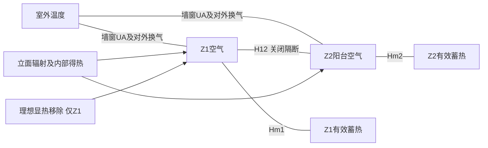

# 模型、参数与核验说明

这是公开资料支持的原型情景分析，不是挂牌住宅性能预测，不是306户复现，没有实测校准。原始交接文件、data与geometry_v1均原样保留；新输入为config，唯一热模型源码为model/run.py。本说明对应当前实现，历史大纲不代替运行参数。

## 1 几何

采用净面积Z1=41.1、Z2=6.3 m²，高2.7 m，体积110.97、17.01 m³。东西为x轴、南北为y轴。Z1南侧取y=0，左列宽3.897 m，卧室B深9.5/3.897、卧室A深11.1/3.897，两卧合计北界y=20.6/3.897。右列宽3.728 m，厨房宽1.228 m，北向突出长度由(20.5−3.728×20.6/3.897)/1.228求得。卫生间宽改为2.5 m，深3.1/2.5，厨房深2.6/1.228，客厅是右列扣除厨房及卫生间后的剩余14.8 m²。阳台宽3.897、深6.3/3.897。

这是为面积守恒重建的简化轮廓，不是按图测量的精确复原。原2.38 m卫生间宽调整为2.5 m，所有深度按面积协调；不保留彼此冲突的尺寸链。外周闭合多边形、墙段、扣窗面积见config/geometry_v2.json、results/geometry_surfaces.csv。内部房间仅为面积构造依据，Z1不解算逐房间温度。

E08/E09取绝热邻接边界，其他外周外露；所有地板、顶板绝热，中间楼层。绝热不意味着忽略有效蓄热。外窗沿用v1整窗面积，Z1=3.525 m²，Z2=14.07 m²，缩放窗面积时同步扣减不透明墙面积，气体积不变。阳台隔断长3.897×2.7 m²，关闭玻璃门5.04 m²，余为实体内墙。朝向N/E/S/W对应0/90/180/270°，只是研究假设；敏感性旋转±30°。

## 2 RC网络与单位

状态x=[Ta1,Tm1,Ta2,Tm2]，单位°C。两空气节点各有独立有效蓄热节点。所有导热系数H单位W/K、容量C单位J/K、热流Q单位W。

对区域i、另一区域j：

Cai dTai/dt = Hoi(To−Tai) + Hmi(Tmi−Tai) + H12(Taj−Tai) + f Qsol,i + 0.5 Qint,i + Qopaque,i − Qcool,i

Cmi dTmi/dt = Hmi(Tai−Tmi) + (1−f)Qsol,i + 0.5 Qint,i

Hoi = Uwall Aopaque,i + Uwindow Awindow,i + ρ cp Vi ACHi/3600

Cai=ρ cp Vi；ρ=1.2 kg/m³，cp=1006 J/(kg K)。Cmi=165 kJ/(m² K)×Ai，Hmi=9.1 W/(m² K)×Ai，二者为探索性有效参数，不是材料质量加总或针对本住宅校准值。分别检验80/260 kJ/(m² K)和4.55/18.2 W/(m² K)。

H12 = Upartition,opaque Apartition,opaque + 6.7×5.04 + ρ cp V2×0.1/3600。

0.1 h⁻¹以较小阳台体积为基准，表示关闭隔断的对称显热空气混合，单位换算后仅在两区间等量反向交换，不是对外换气。隔断夜间仍关闭；各区夜间直接对外开窗，不能把区间流量等同Z1室外ACH。此处不求解压力、气流质量平衡及风压驱动通风网络。

外墙导热率与厚度取补充材料Table S1，R=0.13+Σ(d/λ)+0.04；隔断实体墙R=0.13+Σ内墙(d/λ)+0.13。表面热阻为研究假设。可疑混凝土比热2500与网层密度2.5不参与上述R和Ceff计算，不静默改写，也不使用旧306的容量。

这是含内部有效蓄热的低阶网络：围护热阻以无容量UA直接连接空气，聚合蓄热节点代表内部可参与日周期换热的构件；没有另串联同一外墙热阻，因此没有UA重复。模型不能描述真实多层墙内部相位或辐射表面温度；采用空气/蓄热得热拆分是低阶近似，并不意味着计算了平均辐射温度。

## 3 太阳辐射与时间

原始天气为Open-Meteo返回的ERA5网格(30.25°N,120.25°E)，Asia/Shanghai，固定UTC+8，无夏令时。CSV与原始JSON逐值比对；每年2208条，逐小时连续、无缺值。温度/湿度/风速是端点字段，辐射为截至该时刻的前一小时均值。模拟将辐射记录t对应到[t−1h,t)，太阳位置取t−30min，室外温度取相邻两端点平均，并在该小时保持不变。最初一小时缺少前端点，取第一温度恒定。首标签6月1日00点对应5月31日23点至6月1日00点，末标签8月31日23点对应22—23点；保留全部2208条源数据，没有编造末端缺少的一小时。这相对严格日历夏季整体早一小时，须在论文数据期说明中保留。

太阳位置采用NOAA常用分数年赤纬、时间方程近似，由本地标准时间与经度换算太阳时，不调用网络。垂直面：

Ibeam = DNI max(s·n,0)，太阳在地平线以下设零；Idiffuse=DHI/2；Iground=GHI×0.2/2。

s为太阳单位矢量，n为立面外法线。天空散射为各向同性模型，地面反照率0.2；无遮挡邻楼/树木，不含阳台顶板几何遮挡、角度相关SHGC与镜面反射。小时均值DNI配中点太阳位置会产生水平辐射重建偏差，QA报告其RMSE；它是时间积分近似的诊断，不是现场辐射验证，也不强制重配原始GHI/DNI/DHI。

整窗透入Q=0.70 A I。S1/S3全天削减所有对外窗直射分量50%，散射与地反射不削减，外墙太阳吸收不受该措施改变；不是已设计遮阳板。敏感性削减25%/100%，100%仍留散射与反射。Z2外窗得热先算总透入，其中25%作为穿过阳台/隔断的有效二次透入份额移交Z1，其余75%留Z2，二者之和等于外窗透入总热。25%是聚合光学假设，非光线追踪/实测，检验0和50%。隔断不能再独立吸收同一束外窗辐射。

每区所得太阳得热40%入空气、60%入有效蓄热。外墙吸收太阳用简化sol-air项Qopaque=Uwall Aopaque α I/ho，α=0.6、ho=25 W/(m² K)，进空气节点。未计天空长波净散热及外墙动态温差，因此极端温度尤其应谨慎解释。

## 4 使用与控制

内部得热仅Z1：18:00—08:00按16.7 W/m²，08:00—18:00按其30%，全天平均11.829 W/m²，日总11.668 kWh_th。这是基于交接文献峰值构建的研究时序，不是住户作息测量；没有再叠加人员、电器、烹饪。50%与150%倍率敏感性必须和基准一起看。Z2无独立内部得热。

S0无新增措施；S1仅直射削减；S2仅夜间通风；S3组合。背景总ACH=0.44，开窗总ACH=1.51，不相加。两区独立控制：每300秒使用步首空气温度判断，时段21:00—07:00且Tin−Tout≥1 K即开，否则关闭；无滞回。湿度、风速保留在天气源资料，但不进入固定ACH显热方程；无雨、安全与噪声控制。OH与DH、实际开启时数均按子步积分；逐时表中的温度是12个子步末温度均值，峰值列保留小时内最高值。夜间窗口每年920小时。

自由运行关闭Qcool，评价空气温度、OH28及DH26/28/30。这些阈值是研究阈值，非合规认证。理想制冷24小时可用，仅Z1上限26°C，不加热，Z2不制冷；每步若自由求解温度高于26，联合求解约束Ta1=26及移热量，允许被动低于26。通风依据该工况自身状态，因此两工况实际开窗时数会不同。制冷无限功率，无设备效率、湿负荷与风机耗电，输出kWh_th及kWh_th/m²，不能解释为电耗。

## 5 数值求解与预热

后向Euler：(C/Δt+L)x_new=(C/Δt)x_old+q−e1 Qcool。制冷通过逆矩阵第一列同时修正四节点，而不是事后只截断空气温度。每个子步检查四个节点能量残差(C/Δt)(x_new−x_old)+Lx_new−q+e1Qcool。

步长300秒，每小时外部输入恒定。初始26°C，预热用首7天反复循环28天，不计入结果；这不是额外取得的5月天气。检验56天预热且初始35°C，以及600/300/150秒步长，两种工况、四情景均运行全年评价期核验。能量残差、稳态理想制冷解析比较、等温无热源、散射条件与几何检查见checks.json。没有实测温度，全部属于数值核验。

## 6 敏感性与交互

每次只改变一个主要参数，每个变体在两年四情景两工况均重跑；方案收益必须相对于该变体自身S0。主分析ACH=0.8/3，Ceff=80/260，外窗面积倍率0.8/1.1（同时改变不透明墙面积），直射削减0.25/1；补充温差门槛0/2、阳台二次透入0/0.5、得热倍率0.5/1.5、朝向±30°、空气蓄热耦合0.5/2倍，以及E08/E09改为对外。后者仍无新增窗，是边界暴露敏感性。并非概率抽样，不输出置信区间；OAT不能代替多参数全局分析。

对DH28及理想制冷量D：Bi=D0−Di，I=B3−B1−B2=D1+D2−D3−D0。正值才是超相加，负值为收益递减。代表周取室外端点温度168小时滚动均值最大的一段，并列取最早，不按措施收益挑选。

## 7 来源核对边界

已本地核对：公开户型图；Short等(2018)正文标题、作者、16.7 W/m²与50%/100%直射遮挡段落；补充材料Table S1厚度/导热率及异常值；天气原始JSON、CSV及查询URL。主论文为Challenges in the low-carbon adaptation of China’s apartment towers，Building Research & Information 46(8),899–930，DOI 10.1080/09613218.2018.1489465；补充材料DOI 10.6084/m9.figshare.6803489.v1。16.7与遮挡段落在印刷页909附近，最终投稿引用仍需人工核对版面。

整窗6.7/0.70的BASIX item5、ACH的Hou等2019 Table6（DOI 10.1111/ina.12582）目前沿用交接登记的外部文献代理值，本轮没有其全文，不声称独立复核了外部原表。工作L1—L8未作为新增数值依据。数据来源URL原样保存在data/03_weather_recent；原文献PDF及元数据保留，书目不作编造补齐。
