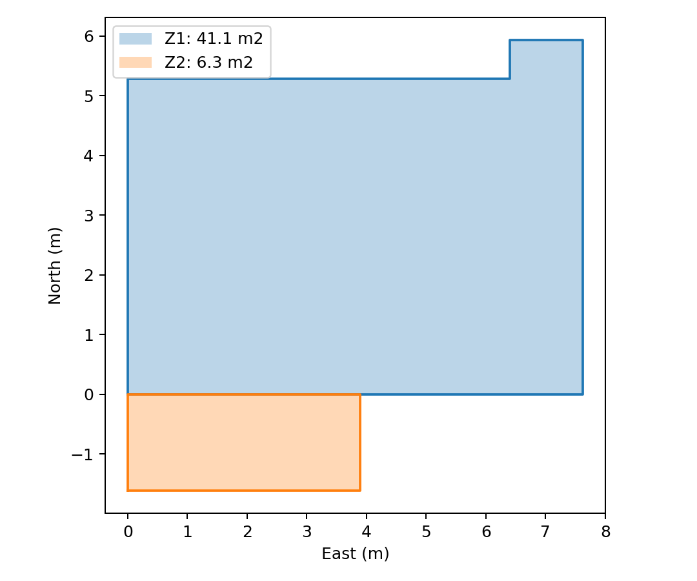
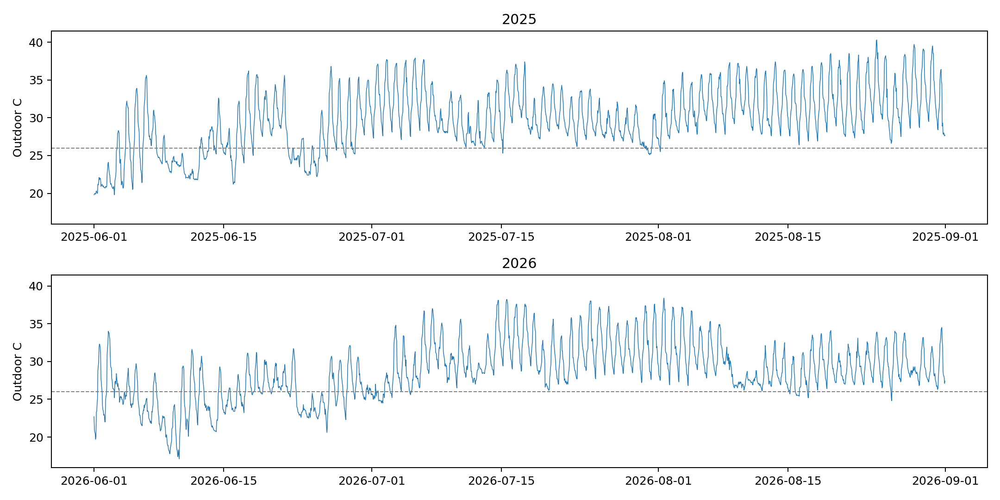
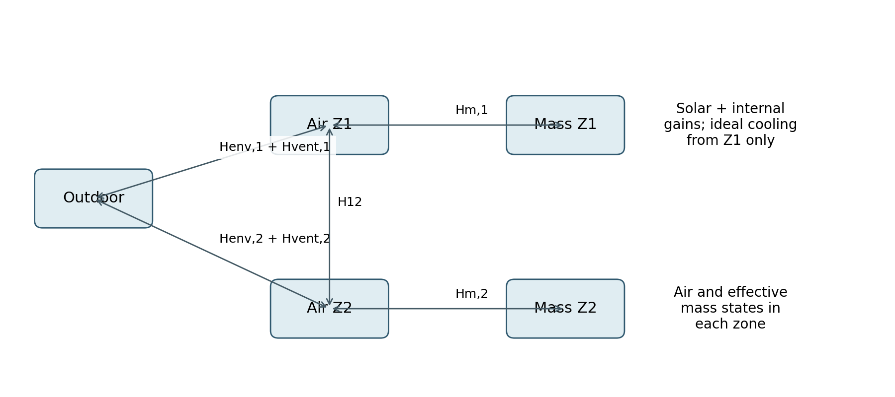
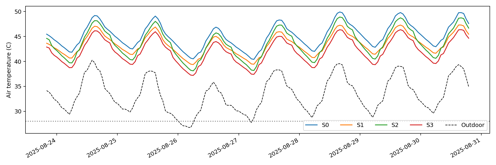
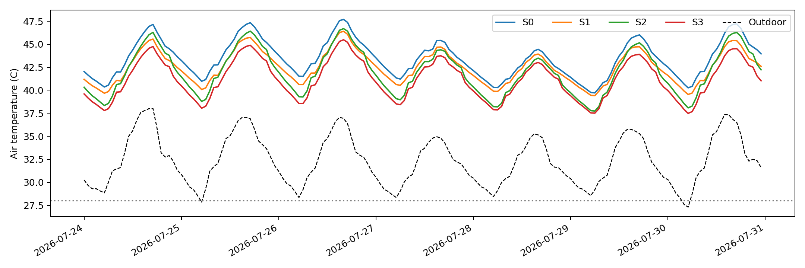
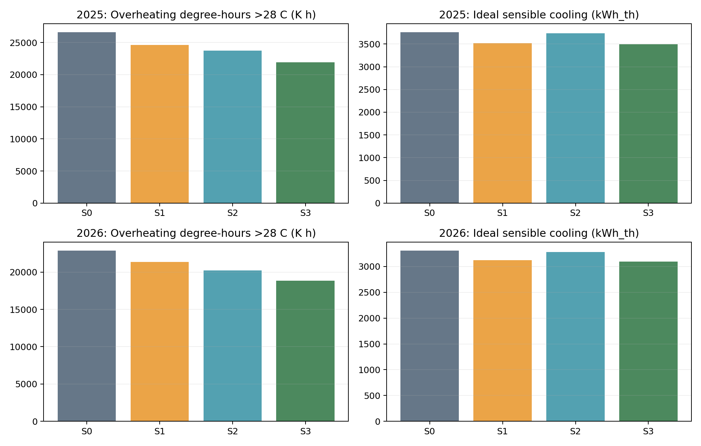
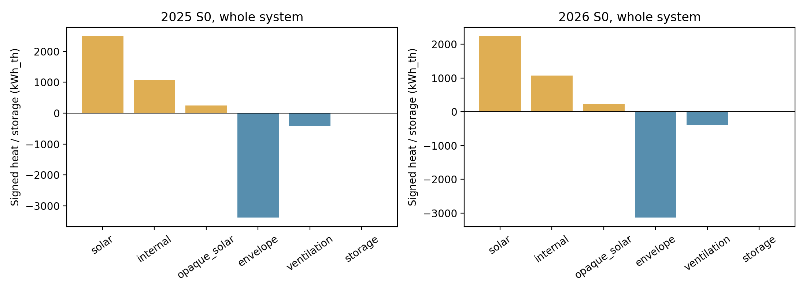
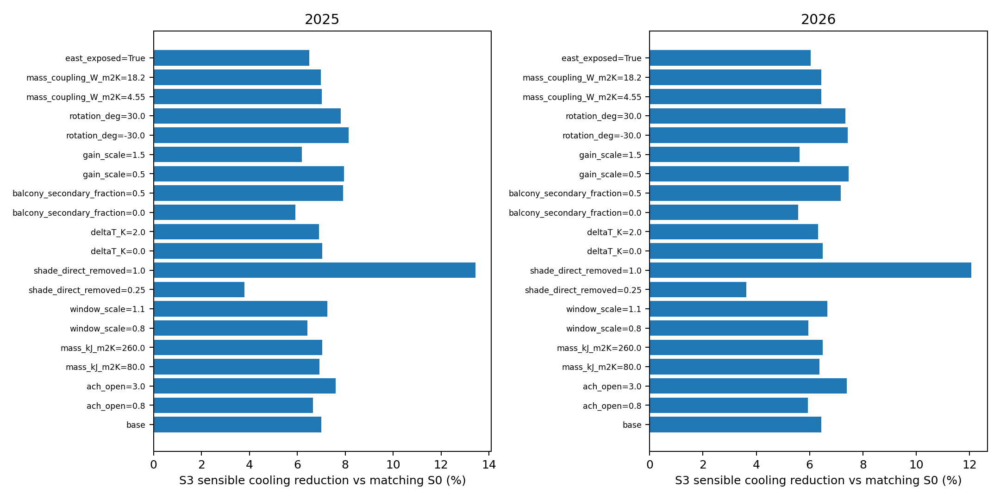
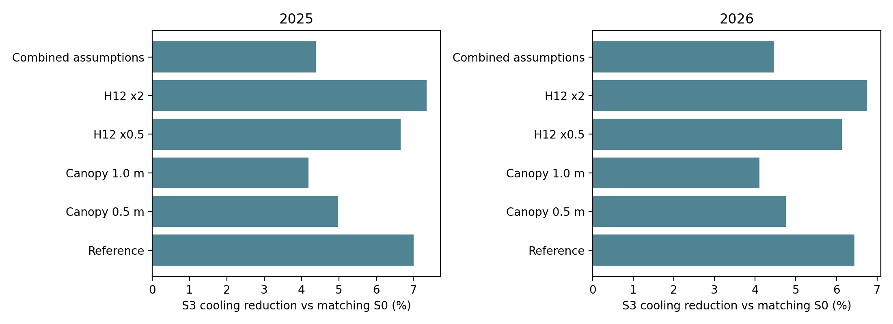

# 杭州夏季住宅外遮阳与夜间通风的降温效果及显热制冷需求
## 基于住宅原型的两热区热网络模拟
中文论文草稿 v0.1｜2026年11月7日
草稿说明：本文为可继续修改的课程论文初稿。研究定位为公开资料支持的原型情景模拟，未进行实测校准；作者、课程信息及最终格式待补。主分析保留可追溯的参考基准，并将阳台遮挡等结构假设作为补充对照，避免为匹配预期温度而调整参数。

## 摘要
外遮阳与夜间通风分别通过减少太阳得热和利用室内外温差排热改善夏季热环境，但其组合收益与建筑热容量、夜间天气及控制方式有关。本研究以杭州公开户型建立居住区41.1 m²、阳台缓冲区6.3 m²的两热区四节点RC模型，使用2025、2026年夏季各2208小时ERA5天气资料，比较基准S0、外遮阳S1、夜间通风S2及组合S3。自由运行与26°C全天理想显热制冷分别求解，并开展参数敏感性、热量收支和阳台结构假设对照。参考基准下，S3使两年居住区平均空气温度分别降低2.12°C和1.85°C，28°C以上过热度时分别降低17.51%和17.71%，理想显热制冷需求分别降低7.01%和6.44%。组合措施的交互收益为负，表现为收益递减；自由运行时的通风改善不能直接转化为同等比例的制冷需求降低。全部已测试主参数变体中S3均最低，但单项措施排序随参数改变。基准自由运行出现较高绝对温度，热量收支及结构对照表明其受太阳得热、内部得热和阳台处理影响，因此结果用于既定原型的措施比较，不直接代表杭州住宅实际室温、设备用电或普适节能率。
关键词：外遮阳；夜间通风；住宅原型；RC热网络；夏季过热；显热制冷需求；杭州

## 1 引言
住宅夏季降温既涉及主动制冷，也涉及建筑对太阳辐射、室外空气和蓄热的利用方式。外遮阳减少热量进入，夜间通风则在室外较凉时带走室内及构件中积累的显热。两种措施在运行层面具有互补可能，但互补机制并不意味着收益必然相加，更不能在气候和建筑条件不同的研究之间直接套用降温幅度或节能百分比。
杭州住宅研究为这一问题提供了具体背景。Short等对杭州公寓塔楼的研究讨论了封闭阳台玻璃、朝向和遮挡与夏季过热的关系，并比较了削减太阳直射与增强通风的适应策略[1]。该研究可以支持本项目的方法选择和构造参考，但其户型、气象、监测与模型均不能直接替代本研究原型的输入或验证资料。
本研究关心三个问题：其一，在相同原型和两个夏季天气下，遮阳、夜间通风及组合如何改变空气温度、过热及显热制冷需求；其二，组合改善相对于单项改善之和表现为协同还是收益递减；其三，换气率、有效热容量、窗面积及阳台处理的不确定性是否改变措施排序。研究将自由运行与理想制冷分开计算，以避免将被动降温幅度误写为实际节电效果。
研究贡献在于以透明的低阶模型连接地方天气、公开几何、措施控制和参数不确定性，并通过热量收支检验解释结果。本文不声称提出新的遮阳或通风技术，也不声称一个原型能够代表杭州全部住宅。

## 2 相关研究与方法选择
### 2.1 外遮阳及封闭阳台得热
外遮阳的直接作用是改变窗面太阳入射及透入热量。效果取决于朝向、时段、直射与散射比例、玻璃性能，以及既有建筑构件的遮挡。Short等采用50%和100%直射削减方案讨论杭州公寓适应性[1]，为本研究的参数化措施提供了参考。本文沿用“明确削减直射分量”的表达，不将其描述为已完成尺寸设计的实体遮阳板。即使直射完全消除，散射和地面反射仍可形成得热。
封闭阳台既可能缓冲室内外温差，也可能在太阳辐射下升温并向居住区传热。因此，将阳台所有玻璃得热直接加到居住区会省略缓冲过程，而将同一束辐射分别计入两个热区会重复计热。本文单独设置阳台空气及有效蓄热节点，并保持外窗透入热量在两个热区之间的分配守恒。
### 2.2 夜间通风、热容量与控制
Artmann等的参数研究指出，夜间通风效果受气候、风量、热容量及内部得热影响[6]。其研究对象和模型与本文不同，本文只借鉴这些作用机制和敏感性思路，不移用其量化舒适结论。Hou等对中国城市卧室的研究提供了开闭窗条件下的换气率资料[3]；这些实测群体参数可以作为探索性代理，但不能等同于本住宅的实际换气率。
夜间通风的显热收益由风量与温差共同决定。同一控制在高温自由运行空间可能频繁满足开启条件，在接近26°C的制冷空间则可能仅有少量机会。由此，评价必须同时报告夜间窗口、实际开启时数和所移除热量，而不能只按“设置了夜间通风”判断其效果。
### 2.3 简化热网络的适用范围
本文选择热网络是为了明确列示能量路径，并以较低计算成本比较多组假设。模型求解区域平均空气温度和有效蓄热温度，不计算逐房间温差、表面辐射温度和湿度平衡。有效热容量是对日周期参与蓄热部分的聚合描述，不是全部构件质量与比热的直接加总。本研究属于聚焦性资料支持的模拟分析，文献集合不构成系统综述。

## 3 住宅原型、天气与参数
### 3.1 几何及热区划分
几何来源为公开挂牌住宅户型图[7]。挂牌建筑面积71.05 m²不用于空气体积计算；按房间标注面积采用居住区Z1=41.1 m²、阳台Z2=6.3 m²，高度统一假设2.7 m，体积分别110.97和17.01 m³。居住空间内部充分混合，阳台与居住区之间假设有可关闭隔断，基准运行始终关闭。
为消除图示尺寸链的不一致，建立与目标面积一致的闭合简化轮廓：左列宽3.897 m，卧室进深按面积除以宽度推导；右列宽3.728 m，协调卫生间和厨房尺寸，客厅面积取余；阳台进深为6.3/3.897。该几何是研究者重建，不是挂牌住宅的精确测绘。中间楼层的上下边界取绝热，东侧两段墙取邻接绝热，其余边界外露。直接对外整窗面积Z1=3.525 m²、Z2=14.07 m²，窗高和门窗尺寸均属于原型假设。

### 3.2 天气及时间处理
主输入为Open-Meteo获取的ERA5逐小时天气[5]，2025、2026年各2208条记录。请求点为30.2662°N、120.1260°E，返回格点30.25°N、120.25°E，高程元数据11 m；采用Asia/Shanghai即UTC+8。CSV与原始JSON对应字段逐值核对，两年均连续且无缺值。网格再分析不等于住宅现场观测，也无法完整描述楼旁遮挡、风场和热岛差异。
官方说明中温度为时点值，辐射为前一小时均值[5]。记录t对应积分区间[t−1 h,t)，太阳位置取区间中点，室外温度取相邻时点平均。首区间缺少前温度端点，取第一值代替。保留全部源记录后，实际区间为5月31日23:00至8月31日23:00，相比严格日历夏季整体提前一小时；本文所有方案采用同一口径，不补造末端天气。湿度和风速保存在源数据，但不进入本版固定ACH显热模型。
表1 两年原始天气统计。夜间按源时间标签21:00—07:00统计，用于描述天气；控制开启时数另按区间中点及子步状态计算。
| 年份 | 平均°C | 最高°C | 夜间平均°C | 夜间低于26°C时数 |
|---|---|---|---|---|
| 2025 | 29.80 | 40.3 | 27.66 | 217 |
| 2026 | 28.71 | 38.4 | 26.88 | 281 |

### 3.3 参数身份与构造
外墙及隔断实体构造采用Short等补充材料Table S1的厚度和导热率[2]。外墙热阻包括内外表面热阻0.13和0.04 m²·K/W，实体隔断两侧各取0.13 m²·K/W，表面热阻为本研究假设。原表混凝土比热和网层密度存在疑点，本研究原样保留，不将它们用于有效热容量。
整窗U与SHGC取NSW官方默认窗表第5项，即透明单玻铝框固定／推拉窗的6.7 W/(m²·K)和0.70[4]；这只是代表性代理，不证明实际房源窗型。ACH取Hou等作者公开稿Table 6夏热冬冷地区14户夏季夜间开闭窗中位值1.51和0.44 h⁻¹[3]。将卧室夜间参数应用到两个聚合热区及全天背景换气，仍属于本研究外推假设。
内部得热以16.7 W/m²为高得热时段值，18:00—08:00取该值，其余时段取30%，全天平均11.829 W/m²，Z1日累计11.668 kWh_th。原文只给出模型内部得热假定[1]，并未提供本研究的高低时段作息；16.7不是实测峰值。该时序与实际住户无对应验证，不额外叠加人员或家电得热。
表2 关键基准参数及身份。完整几何、材料与参数登记随项目提供。
| 参数 | 基准值 | 身份／说明 |
|---|---|---|
| 净面积及层高 | 41.1＋6.3 m²；2.7 m | 图示面积作为假设；高度假设 |
| 外墙U | 1.121 W/(m²·K) | 材料热阻推导＋假设表面热阻 |
| 整窗U／SHGC | 6.7 W/(m²·K)／0.70 | 外部默认构造代理[4] |
| 关闭／开启总ACH | 0.44／1.51 h⁻¹ | 卧室群体参数代理[3] |
| 有效容量密度 | 165 kJ/(m²·K) | 研究假设；非构件总容量 |
| Z1／Z2有效容量 | 6.782／1.040 MJ/K | 面积乘以容量密度 |
| 空气—蓄热耦合 | 9.1 W/(m²·K)×地面面积 | 聚合参数假设 |
| 隔断总耦合H12 | 47.45 W/K | 实体墙、玻璃及区间混合之和 |
| 阳台二次透入份额 | 25% | 守恒分配假设；非实测透射率 |
| 新增遮阳直射削减 | 50% | 策略假设；不削减散射和地反射 |
| 内部得热高／低值 | 16.7／5.01 W/m² | 文献数值＋自定时序 |
| 理想制冷 | Z1上限26°C，全天可用 | 无限功率显热移除；Z2不制冷 |

## 4 研究方法
### 4.1 两热区四节点RC方程
状态向量为x=[Ta1,Tm1,Ta2,Tm2]ᵀ。其中Tai为空气温度，Tmi为有效蓄热温度。各区空气容量Cai=ρcpVi，ρ=1.2 kg/m³，cp=1006 J/(kg·K)；蓄热容量Cmi=c_eff Ai。温差单位为K，热流为W，导热系数为W/K。
对区域i和另一区域j，能量平衡为：
Cai dTai/dt = Hoi(To−Tai) + Hmi(Tmi−Tai) + H12(Taj−Tai) + f Qsol,i + 0.5 Qint,i + Qopaque,i − Qcool,i  （1）
Cmi dTmi/dt = Hmi(Tai−Tmi) + (1−f)Qsol,i + 0.5 Qint,i  （2）
Hoi = Uwall Aopaque,i + Uwindow Awindow,i + ρcpVi ACHi/3600  （3）
太阳得热分配系数f=0.4；Z2无内部得热且不制冷。Hmi=9.1Ai。H12由隔断实体墙UA、5.04 m²玻璃门UA及以阳台体积计0.1 h⁻¹的对称区间显热交换组成；区间交换在全系统中等量反向抵消，不与室外ACH混用。
围护热阻以无容量UA直接连接空气，有效蓄热通过Hmi连接空气；没有再串联重复的外墙热阻。该低阶网络不显式描述多层墙内温度分布和相位滞后。它可用于统一假设下的对照，但不能声称具有详细模拟或实测模型相同的预测精度。

### 4.2 立面辐射与热量分配
太阳赤纬和时间方程采用分数年近似，结合经度及本地标准时间计算太阳方向。朝向法线以北0°、东90°、南180°、西270°表示。垂直窗面辐射由直射、各向同性散射和地面反射构成：
Iplane = DNI max(s·n,0) + DHI/2 + ρg GHI/2  （4）
其中ρg=0.2，太阳在地平线以下时直射取零。整窗透入热为SHGC×整窗面积×Iplane，不再重复乘玻璃比例。S1／S3将直射分量乘以0.5，散射及地反射保持。
阳台窗总透入热先独立计算，再将25%有效二次透入移交Z1，其余75%留Z2；两区分配之和等于外窗透入总热，后续隔断传热不重复生成辐射源。该份额是简化光学假设，不能视为玻璃门产品参数。墙体太阳吸热采用Qopaque=Uwall Aopaque α Iplane/ho，α=0.6、ho=25 W/(m²·K)，作为空气节点得热；没有计算天空长波净辐射。
### 4.3 通风控制与四情景
通风显热项为Qvent=ρcpV ACH(To−Tin)/3600。当外气温度较低时该项为负，表示排热。基准仅有总ACH=0.44 h⁻¹；策略开启时总ACH切换至1.51 h⁻¹，而非再加背景换气。
表3 情景及控制设置。
| 情景 | 外窗直射削减 | 夜间通风 |
|---|---|---|
| S0 | 无新增削减 | 仅背景换气 |
| S1 | 50% | 仅背景换气 |
| S2 | 无新增削减 | 21:00—07:00且Tin−Tout≥1 K开启 |
| S3 | 50% | 与S2相同规则 |

两区各自依据本区空气温度判断开窗，隔断始终关闭。每个300秒子步使用步首状态判断，无滞回；小时内室外输入保持不变。没有模拟降雨、噪声、安全或湿度约束，因此是可执行的显热控制假设，不是住户实际行为预测。
### 4.4 两种评价工况与指标
自由运行令Qcool=0，计算Z1平均与峰值空气温度。过热时长OHθ=Σ1(Ta1>θ)Δt，过热度时DHθ=Σmax(Ta1−θ,0)Δt；Δt以小时表示，主阈值θ=28°C，并补充26°C和30°C。阈值是本研究比较用数值，不宣称其为经过核定的舒适合规线。
理想制冷工况对Z1施加26°C上限，每步只在需要时移热，不加热；Z2自由运行。累计显热需求Ecool=ΣQcool Δt/1000，单位kWh_th；按41.1 m²归一化。该量不包含除湿、设备效率和风机电耗。两种工况分别使用各自状态进行通风判断，不共用自由运行的开窗序列。
对过热度时或显热需求D，定义Bi=D0−Di，组合交互I=B3−B1−B2。I>0才表示超过单项相加收益；I<0表示收益递减。报告绝对量和比例，分母为零时不计算比例。代表周按室外温度168小时滚动均值最大且并列取最早的规则选择，与措施收益无关。
### 4.5 数值求解、热量收支与复核
使用后向Euler：(C/Δt+L)x_new=(C/Δt)x_old+q−e1Qcool。理想制冷通过约束Ta1=26°C同时修正四节点，不是求解后单独截断空气温度。步长300秒；用首7天气象反复循环28天预热，预热不进入指标。预热属于合成数值初始化，不是假装取得了5月天气。
每步记录围护传热、通风、太阳与内部得热、区间交换、制冷及空气／蓄热储能。区域总平衡在式（1）与式（2）相加后检验，空气—蓄热交换为内部流量；全系统还应抵消区间交换。累计分别保留正向、负向与净值，避免季节净值掩盖方向变化。
基准采用等温无热源、稳态理想制冷、太阳分配、几何面积、节点残差、600／300／150秒步长及预热初值检查。补充模型须再现基准逐时结果，并检查区域总平衡和新增工况步长。全部检查属于物理与数值核验，不是实测校准。
### 4.6 参数及结构假设对照
主分析以单因素方式改变开窗ACH 0.8／3.0 h⁻¹、有效容量80／260 kJ/(m²·K)、窗面积倍率0.8／1.1及直射削减25%／100%；另检验控制温差、二次透入、内部得热、朝向、空气—蓄热耦合及东侧外露边界。包括基准共20套输入，每套均重跑两年四情景和两工况，共320组季节运行。窗面积改变时同步更新不透明墙面积。
另设置玻璃外侧水平挑檐出挑0.5／1.0 m、总隔断耦合0.5／2倍，以及“1.0 m挑檐＋内部得热减半＋无直接二次透入”的联合假设对照。挑檐按无限宽、紧邻阳台每块2.1 m高玻璃顶部处理，直射遮挡比例为min[1,D sz/(h(s·n))]，仅在太阳正对窗面时计算；本对照没有计算天空视域减少及侧边漏光，不是实际阳台顶板的精确还原。D指玻璃外侧出挑，不等于阳台内深。既有挑檐对照在S0—S3中一致应用，与新增50%直射削减按剩余直射相乘。
保留参考基准的理由是缺少真实挑檐、窗和住户作息测量；附加对照用于揭示结论的条件性，而非用较低温度替换不利结果。零内部得热和零太阳得热仅用于热源诊断，不构成新增正式措施。

## 5 结果
### 5.1 数值核验
基准300秒减至150秒后，2025年四情景两工况关键累计指标最大相对变化为0.00569%，最大峰值变化约0.003°C。将预热延长至56天并将初值改为35°C后，基准累计指标差异接近浮点误差。补充模型与既有逐时温度的最大差异为5.00e-07 K，处于已有CSV输出精度内；补充运行区域总热平衡最大小时平均残差为4.15e-10 W。新增遮挡与联合假设的S3两年两工况步长检查最大相对变化为0.0075%。这些结果支持离散求解的一致性，不构成真实住宅预测误差的证据。
### 5.2 自由运行及过热
表4 两年四情景自由运行结果。峰值为300秒子步峰值，OH／DH由子步积分，非逐时均温重算。
| 年份 | 情景 | 均温°C | 峰值°C | OH28 h | DH28 K·h | DH28降低% |
|---|---|---|---|---|---|---|
| 2025 | S0 | 40.04 | 50.11 | 2206.8 | 26593.1 | 0.00 |
| 2025 | S1 | 39.14 | 47.54 | 2206.2 | 24601.3 | 7.49 |
| 2025 | S2 | 38.73 | 49.12 | 2173.8 | 23724.5 | 10.79 |
| 2025 | S3 | 37.92 | 46.59 | 2172.0 | 21935.9 | 17.51 |
| 2026 | S0 | 38.36 | 47.84 | 2198.8 | 22884.1 | 0.00 |
| 2026 | S1 | 37.67 | 46.54 | 2194.2 | 21348.8 | 6.71 |
| 2026 | S2 | 37.14 | 46.97 | 2181.2 | 20206.4 | 11.70 |
| 2026 | S3 | 36.51 | 45.64 | 2179.8 | 18830.9 | 17.71 |
S3在参考基准中平均降温为2025年2.12°C、2026年1.85°C，峰值分别降低3.53°C、2.20°C。两年DH28分别降低17.51%和17.71%，但S3仍有2172.0和2179.8小时超过28°C，表明改善并未消除本原型的夏季过热。S0峰值50.11°C和47.84°C是模型输出，不能据此断言挂牌住宅会达到同样温度。
代表高温周分别为2025年8月23日20:00起168小时、2026年7月24日00:00起168小时，均由室外天气事先规则选取。图4、图5显示措施改变温度轨迹；仅凭峰值降低不足以判断整季过热是否得到控制。

### 5.3 理想显热制冷需求与夜间机会
表5 26°C理想显热制冷结果。通风时数按各区独立控制统计，每年预设夜间窗口920小时。
| 年份 | 情景 | kWh_th | kWh_th/m² | 降低% | Z1开窗h | Z2开窗h |
|---|---|---|---|---|---|---|
| 2025 | S0 | 3757.0 | 91.41 | 0.00 | 0.0 | 0.0 |
| 2025 | S1 | 3514.7 | 85.52 | 6.45 | 0.0 | 0.0 |
| 2025 | S2 | 3735.3 | 90.88 | 0.58 | 164.0 | 770.2 |
| 2025 | S3 | 3493.8 | 85.01 | 7.01 | 164.0 | 656.2 |
| 2026 | S0 | 3308.6 | 80.50 | 0.00 | 0.0 | 0.0 |
| 2026 | S1 | 3121.6 | 75.95 | 5.65 | 0.0 | 0.0 |
| 2026 | S2 | 3281.7 | 79.85 | 0.82 | 206.0 | 722.0 |
| 2026 | S3 | 3095.4 | 75.31 | 6.44 | 206.0 | 636.8 |
S3显热需求由2025年3757.0降至3493.8 kWh_th、2026年3308.6降至3095.4 kWh_th，分别降低7.01%和6.44%。S1降低6.45%和5.65%，而S2仅降低0.58%和0.82%。理想制冷中遮阳的需求降低大于通风，与自由运行DH28中通风优于50%直射遮阳的排序不同。
自由运行的S2／S3中，Z1在两年均满足全部920小时夜间开启；理想制冷下，Z1实际开启仅164和206小时，约占窗口17.8%和22.4%。原因在于控制门槛相对于本区温度判断：空气维持26°C附近时，外气通常需低至约25°C才满足1 K差值，而自由运行的高室温产生更长的显热排热机会。该比较说明控制状态改变可以使同一通风策略具有不同收益，不能将自由运行降温直接换算为制冷需求降低。

### 5.4 组合交互
以DH28为指标，2025和2026年组合交互I分别为−203.14和−159.67 K·h；以理想显热需求为指标，分别为−0.876和−0.745 kWh_th。两年均未出现超过两项单独收益相加的协同。制冷交互量不足1 kWh_th，实际解释应侧重近似相加、略有收益递减，而非对很小差别赋予统计显著性。组合最低与超相加协同是不同判断。
### 5.5 热量收支与高温来源
表6 S0自由运行的分区季节热量收支，单位kWh_th。正值表示流入该区或净储能增加，负值表示向外排热或净储能减少。太阳为分配后的值，区间交换两区抵消；不再将空气—蓄热内部交换加到系统输入中。
| 年 | 区 | 太阳 | 内部 | 墙太阳 | 围护 | 通风 | 区间 | 储能 |
|---|---|---|---|---|---|---|---|---|
| 2025 | Z1 | 965.6 | 1073.5 | 214.6 | -1628.4 | -370.4 | -243.7 | 11.2 |
| 2025 | Z2 | 1523.8 | 0.0 | 29.0 | -1750.3 | -43.9 | 243.7 | 2.2 |
| 2026 | Z1 | 875.5 | 1073.5 | 198.7 | -1534.8 | -349.1 | -253.8 | 10.0 |
| 2026 | Z2 | 1360.9 | 0.0 | 25.9 | -1598.9 | -40.1 | 253.8 | 1.6 |
2025年两区系统窗太阳得热共2489.4 kWh_th，内部得热1073.5 kWh_th，外墙太阳项243.5 kWh_th；围护与背景通风净排热分别为3378.7和414.3 kWh_th。2026年两区系统窗太阳得热共2236.5 kWh_th，内部得热1073.5 kWh_th，外墙太阳项224.5 kWh_th；围护与背景通风净排热分别为3133.7和389.2 kWh_th。Z1直接对外窗太阳得热在2025／2026年分别为457.7／421.9 kWh_th，从阳台分配的有效二次透入为507.9／453.6 kWh_th，两者相加构成Z1表中太阳项。与此同时，Z1经隔断向阳台的季节净显热传递为243.7／253.8 kWh_th，说明阳台在本基准中夏季评价期的净温差交换表现为居住区排热路径；不能将阳台所有作用笼统解释为向室内增热。二次太阳透入与温差传热方向不同，必须分别保留。较大的窗太阳输入与持续内部得热共同抬高自由运行温度，围护与低背景换气通过更大温差排出热量；季节储能差较小并不意味着日内没有蓄热。区间热流在部分时段可以换向，因此阳台不能简单视作始终向居住区供热的固定热源。其直接二次透入和温差传热应分别评价。

表7 热源诊断。zero_internal为移除内部得热，zero_solar为同时移除窗与外墙太阳项；其余条件相同，只用于辨识热源。
| 年 | 诊断 | 均温°C | 峰值°C | DH28 K·h | 理想kWh_th |
|---|---|---|---|---|---|
| 2025 | base | 40.04 | 50.11 | 26593.1 | 3757.0 |
| 2025 | zero_internal | 36.02 | 46.69 | 18025.8 | 2713.0 |
| 2025 | zero_solar | 33.79 | 38.96 | 12914.7 | 2089.9 |
| 2026 | base | 38.36 | 47.84 | 22884.1 | 3308.6 |
| 2026 | zero_internal | 34.34 | 44.42 | 14300.3 | 2262.2 |
| 2026 | zero_solar | 32.69 | 37.98 | 10535.1 | 1802.0 |
诊断工况分别移除热源后仍保留室外温度、围护、通风与蓄热交换。它们衡量的是模型内相应热源的影响，不对应可直接实施的建筑改造；由于控制与过热截断具有非线性，各诊断降幅也不能简单相加来构造一个“真实温度”。
### 5.6 参数与结构假设敏感性
主参数OAT分析中，S3在两年全部20套输入内DH28和显热需求均最低。S3的DH28相对降低范围为2025年11.29%—26.97%、2026年10.86%—28.06%；显热需求降低范围分别为3.79%—13.43%和3.63%—12.07%。这只是测试情景包络，不是统计置信区间。
自由运行基准排序为S3<S2<S1<S0；将开窗总ACH降至0.8 h⁻¹，或使直射削减达到100%，排序改为S3<S1<S2<S0。理想制冷两年20套输入均为S3<S1<S2<S0。由此，组合在已测试范围内排序稳定，但不能脱离通风能力和遮阳强度宣称某一单项策略普遍更好。

表8 补充结构与联合假设对照。各行均相对于自身四情景基准；挑檐为玻璃外侧出挑的理想化直射对照，不是已知房源构件。
| 年 | 假设组 | S0峰值°C | S3峰值°C | DH28降低% | 制冷降低% |
|---|---|---|---|---|---|
| 2025 | base | 50.11 | 46.59 | 17.51 | 7.01 |
| 2026 | base | 47.84 | 45.64 | 17.71 | 6.44 |
| 2025 | canopy_0.5m | 48.18 | 45.68 | 15.47 | 4.98 |
| 2026 | canopy_0.5m | 47.03 | 45.26 | 16.00 | 4.76 |
| 2025 | canopy_1.0m | 47.21 | 45.20 | 14.66 | 4.19 |
| 2026 | canopy_1.0m | 46.72 | 45.11 | 15.33 | 4.10 |
| 2025 | partition_H_half | 50.08 | 46.57 | 18.19 | 6.65 |
| 2026 | partition_H_half | 47.95 | 45.64 | 18.47 | 6.14 |
| 2025 | partition_H_double | 50.28 | 46.66 | 16.87 | 7.36 |
| 2026 | partition_H_double | 47.80 | 45.69 | 17.00 | 6.76 |
| 2025 | combined_lower_gain | 44.08 | 42.48 | 14.49 | 4.38 |
| 2026 | combined_lower_gain | 43.34 | 41.97 | 15.51 | 4.46 |
base为参考基准；canopy_0.5m／1.0m为阳台玻璃顶部理想挑檐；partition_H_half／double只改变总隔断显热耦合，不改变二次透光；combined_lower_gain为1.0 m挑檐、内部得热减半及无直接二次透入的联合对照。这些结构对照中，两年两种工况的S3仍最低，但绝对温度与相对改善都受边界假设影响。隔断耦合加倍使2025年S0均温降低约0.42°C，峰值却由50.11°C小幅升至50.28°C，说明峰值与季节平均不必同向变化，不能将增强耦合一概解释为改善。联合对照不代表“修正后的真实房源”，也不能只选较低温度组作为论证依据。

## 6 讨论
### 6.1 先减少输入，再利用可用排热条件
参考基准结果支持将太阳控制与夜间排热放在同一能量系统中评价。遮阳减少白天输入，夜间通风增加适宜时段的显热排出；二者组合在测试范围内均有改善。收益递减的可能机制是遮阳降低待排出的热量和夜间室温差，使通风可获得的额外排热收益减少。这里的机制解释依据能量路径和控制设置，并不证明所有住宅都会呈现相同交互符号。
杭州两年样本中，较高夜间室外温度限制了26°C理想制冷下的通风机会。因而，通风作为自由运行过热缓解措施与作为空调负荷削减措施，不能共用一个绩效百分比。实际应用还应考虑湿度及室外空气质量；本模型未求解潜热，不能得出开窗没有湿负担的结论。
### 6.2 高温输出与参数不确定性
较高自由运行温度首先需要通过收支判断是否存在重复或漏算，再通过结构对照识别简化的影响。本次区域收支闭合、二次透入守恒、区间交换抵消与既有结果再现均通过，但这些事实只能排查离散实现中的一致性问题。真实玻璃面积、既有遮挡、入住得热和边界暴露仍未知，模型偏差不能由能量守恒消除。
高温并非单一热源造成。特别是季节账目显示隔断净传热由居住区流向阳台，与阳台贡献的二次太阳透入同时存在；这说明缓冲热区的作用取决于所评价的传热路径与时段，不能预先假定其只会增加居住区热量。太阳和内部得热诊断均改变了温度与显热需求，且遮挡、隔断和联合假设进一步影响结果。低阶模型忽略外墙瞬态与天空长波等过程，也可能改变峰值。因此，本文优先解释同一假设下的相对比较，对绝对温度和负荷保持原型范围限定，不用于该挂牌住宅制冷设备选型。
### 6.3 绿色建筑意义
外遮阳减少运行期间进入的热量，适宜时段通风提供显热排出机会，可作为降低夏季主动制冷需求的被动设计组成部分。不过，组合方案仍存在较大剩余过热，说明“有改善”并不等于无需主动制冷。本文没有设备效率、潜热、年运行时序和生命周期材料数据，不能将结果扩展为实际节电、电费、碳排放或绿色建筑认证结论。
### 6.4 局限与后续方向
本研究的局限包括：一个公开资料原型与假设朝向；两个充分混合热区；固定ACH而非风压通风；有效热容量和耦合缺少现场辨识；聚合二次透入；既有遮挡不确定；仅两个夏季网格天气；以及显热、空气温度评价的边界。OAT分析只考察单参数变化，有限联合对照也不能替代全局不确定性分析。
后续优先工作应是获取能够约束模型的立面／遮挡及使用资料，或在可行条件下取得室温用于独立校准；若研究资源允许，再引入更详细围护、湿度平衡和多住宅样本。它们是改进方向，不作为本次课程原型比较已经完成的内容。

## 7 结论
在本文参考原型、两年ERA5天气和既定控制下，外遮阳、夜间通风及组合均改善自由运行过热。S3平均降温分别为2.12°C和1.85°C，DH28降低17.51%和17.71%，但仍存在大量剩余过热，无法据此判定被动措施足以维持舒适环境。
在Z1全天26°C理想显热制冷下，S3需求分别降低7.01%和6.44%；单项夜间通风仅降低0.58%和0.82%。控制状态压缩可开启时数，是自由运行改善与制冷需求降低存在差异的重要原因。上述热量不等同实际电耗。
组合方案在已测试主参数范围内均最低，但收益没有超过两项单独收益之和，且单项措施排序随通风和遮阳参数改变。热量收支与结构对照支持将阳台和使用假设作为结果解释的重要部分；数值核验不替代实测验证，结论限于明确输入条件下的原型情景比较。

## 参考文献
[1] Short, C. A., Song, J., Mottet, L., Chen, S., Wu, J., & Ge, J. (2018). Challenges in the low-carbon adaptation of China’s apartment towers. Building Research & Information, 46(8), 899–930. https://doi.org/10.1080/09613218.2018.1489465
[2] Short等，2018年上述论文补充材料。Table S1: Liubo building construction materials listed by element. https://doi.org/10.6084/m9.figshare.6803489.v1
[3] Hou, J., Sun, Y., Chen, Q., et al. (2019). Air change rates in urban Chinese bedrooms. Indoor Air, 29(5), 828–839. https://doi.org/10.1111/ina.12582 。参数核对采用作者公开稿Table 6（PDF第12页）：https://engineering.purdue.edu/~yanchen/paper/2019-10.pdf
[4] NSW Government. Default Window Data. Item 5, single-glazed clear aluminium fixed/sliding window. https://www.planningportal.nsw.gov.au/basix-thermal-comfort/diy-method/windows/frame-glass-types/default-window-data （访问：2026-11-07）。
[5] Open-Meteo. Historical Weather API documentation: ERA5 and hourly parameter definitions. https://open-meteo.com/en/docs/historical-weather-api （访问：2026-11-07）。天气源为ERA5／Copernicus，经Open-Meteo接口取得；原始查询及JSON随项目保存。
[6] Artmann, N., Manz, H., & Heiselberg, P. (2008). Parameter study on performance of building cooling by night-time ventilation. Renewable Energy, 33(12), 2589–2598. https://doi.org/10.1016/j.renene.2008.02.025 。本稿机制介绍依据作者大学研究门户摘要，未据其全文提取量化参数。
[7] 杭州学区房公开房源户型资料，71.05 m²住宅。https://www.hzxqf.com/house/120716888258.html 。采用交接包保存图像及来源登记；房源网页未作为现场测量证明。

## 附录A 复现与成果索引
本研究主模型为model/run.py，基准配置config/base.json、几何config/geometry_v2.json。补充热量账目及结构对照由model/draft_model.py、model/draft_analysis.py生成，结果保存在results/draft_diagnostics，草稿由model/write_draft.py读取结果生成。主参数320组汇总为results/all_metrics.csv，基准16份逐时数据为results/hourly；补充阶段不覆盖第一版数据。
在项目目录已有依赖时，设置MPLCONFIGDIR为可写目录并运行：python model/run.py；python model/checks.py；python model/report.py；python model/draft_analysis.py；python model/write_draft.py。全部输入采用项目相对路径，安装依赖后模拟不联网。草稿排版另需python-docx；完整依赖版本随本次附件提供。
逐时曲线为小时内子步末温度平均，子步峰值及过热积分另存。诊断账目提供正／负／净累计热量，空气—蓄热交换仅供内部机制诊断，不计为全系统热源。文献来源的实际读取范围见SOURCE_AUDIT.md。

## 附录B 草稿状态与待修改项
已完成：热量收支诊断、基准再现检查、阳台遮挡与隔断对照、主参数来源核对、数学方法及结果初稿。尚待完善：作者与课程信息、指定引用样式、教师要求下的篇幅调整，以及有资料支持时对真实遮挡和作息的约束。没有课程格式文件时不虚设要求。
注意保留的边界：16.7 W/m²非实测峰值；整窗与ACH虽核实了来源，仍不是本原型实测参数；实际辐射区间相对严格日历夏季早一小时；未计算潜热；未进行室温校准。后续不得删除这些限定后直接把本稿表述为真实住宅预测。
