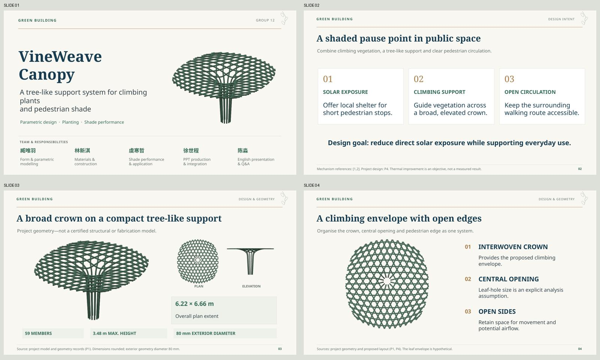

# VineWeave Canopy — First Editable Draft

**green building · Group 12 · 19 slides** (18 presentation slides + 1 reference/Q&A slide).

- **[View all slides in the browser](Preview.md)**
- **[PowerPoint — editable draft](VineWeave-Canopy-v1.pptx)**
- **[PDF — static review version](VineWeave-Canopy-v1.pdf)**
- **[Presenter guide — English script, Chinese cues and Q&A](Presenter-Guide-v1.md)**
- [Presenter guide in Word](Presenter-Guide-v1.docx)

## What is editable?

Titles, descriptions, team/material tables, diagram shapes and five analytical charts are native PowerPoint objects. Each chart includes an embedded Excel workbook. Model views and the two GIF animations remain image assets. This is not a whole-slide raster deck.

The original Rhino geometry/input meshes were used for the model figures; no AI redraw was used for evidence geometry. Geometry labels and scenario metrics are separate editable text or charts.

## Animation and static fallback

Slides 15 and 16 embed text-free GIFs for cover development and daily shadow movement. The chart and English labels remain editable. All frames were retained in the PPT package; actual playback has **not** been verified in desktop PowerPoint, PowerPoint Online or WPS. Test in the intended presentation software.

The PDF and browser gallery use a representative **50% cover** view on slide 15 and **15:00** view on slide 16. They do not play animations. If the presentation software does not play GIFs, use these static references or the supplied frame PNGs.

[Cover animation](assets/cover-sequence.gif) · [Daily-shadow animation](assets/shadow-sequence.gif)

The visual animation frames were regenerated from the supplied input geometry with English labels outside the image. Display raster resolution is not the numerical result resolution. All reported scenario values come from the supplied 5 mm result CSV, not from reading pixels in the preview.

## Presenter support

Each slide has embedded notes with a takeaway, spoken script, transition and likely question. The separate guide adds a Chinese cue. Slides 1–18 contain approximately **985 spoken words including transitions**, around 7.3–8.2 minutes of continuous speech at 120–135 words/minute before figure pauses, animation stops and slide changes. Rehearse towards 8.5–9 minutes, leaving 2–3 minutes for questions; timing is not yet validated by rehearsal.

## Evidence boundaries retained

- Ideal geometric overlap (slide 13) is distinct from equivalent direct-beam blockage (slides 14–15).
- Vegetation stages are spatial scenarios, not months, years or calibrated seasonal growth.
- Joint restraint, global stability, wind resistance, real-site suitability and thermal response are not verified.
- Material properties, cost and carbon factors remain preliminary where documented.
- Literature entries were supplied with project records; online original-source checks remain pending. Per-slide source labels are included.

## Files and checks

See [Validation.md](Validation.md). All 19 pages were rendered and visually reviewed; native charts, workbooks, notes, GIF frames and page bounds were checked. Model views use consistent camera and scale within comparison groups. Browser previews reflect LibreOffice rendering and may differ from Microsoft PowerPoint.

[Source generator](source/build_deck.cjs) · [Scientific-figure generator](source/prepare_assets.py) · [Chart inputs](assets/chart-data.json)

Source scripts refer to the attached project inputs in the onboarding workspace; those original private uploads are not duplicated into this directory. The PPT and PDF are self-contained.

## Cover update

The project title is now dominant; the five team roles occupy a compact lower band instead of a full-slide table. This update only changes the cover, not the proposed expanded V2 content.
