# VineWeave Canopy — V2 Slide Preview

20 slides including references. [Editable PowerPoint](VineWeave-Canopy-v2.pptx) · [Static PDF](VineWeave-Canopy-v2.pdf) · [Presenter guide](Presenter-Guide-v2.md)

Slides 16–17 use static keyframes in this gallery; the PowerPoint embeds their GIFs. The plant-establishment page is a milestone diagram, not a verified month/year prediction.

## Slide 01 — VineWeave Canopy

## Slide 02 — Translate the brief into five design decisions

## Slide 03 — From controlled centre lines to a measurable model

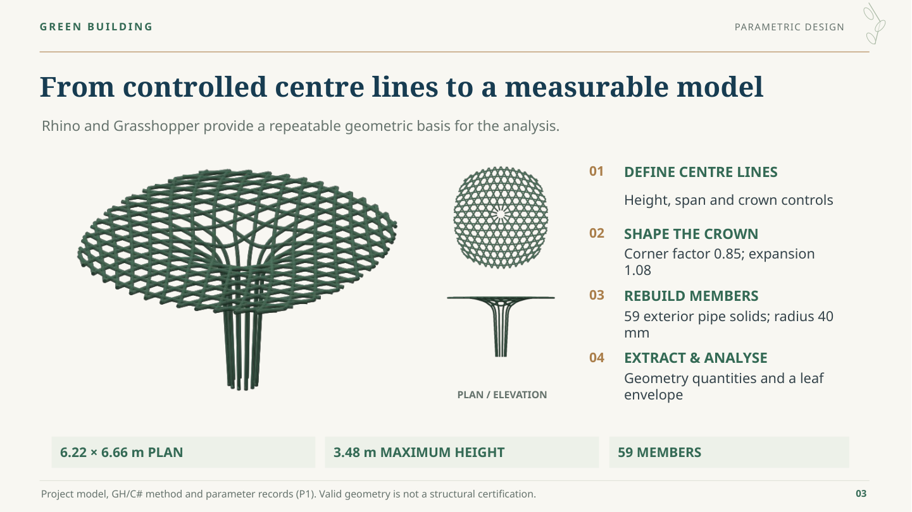

## Slide 04 — Let the crown, opening and edges perform different roles

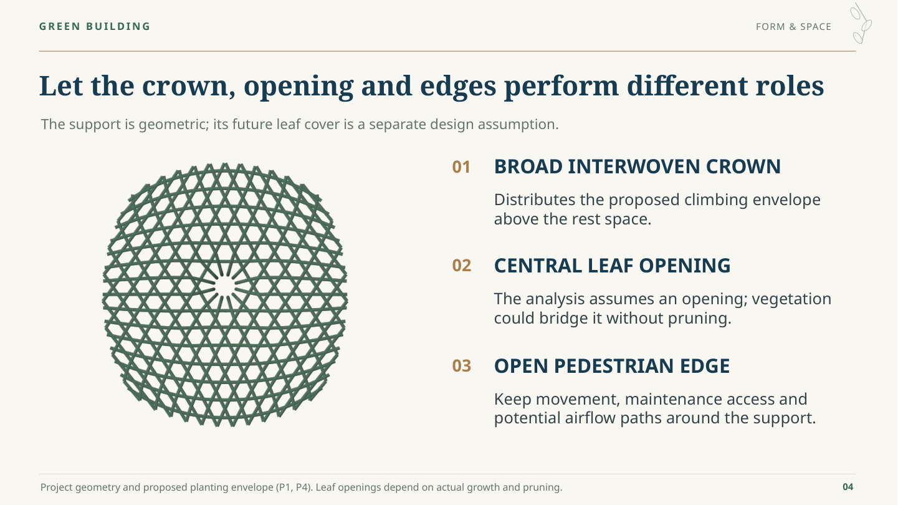

## Slide 05 — Separate the support role from the crown role

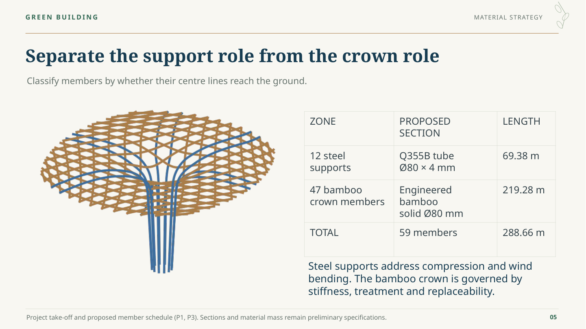

## Slide 06 — Screen strength, cost, carbon and outdoor care together

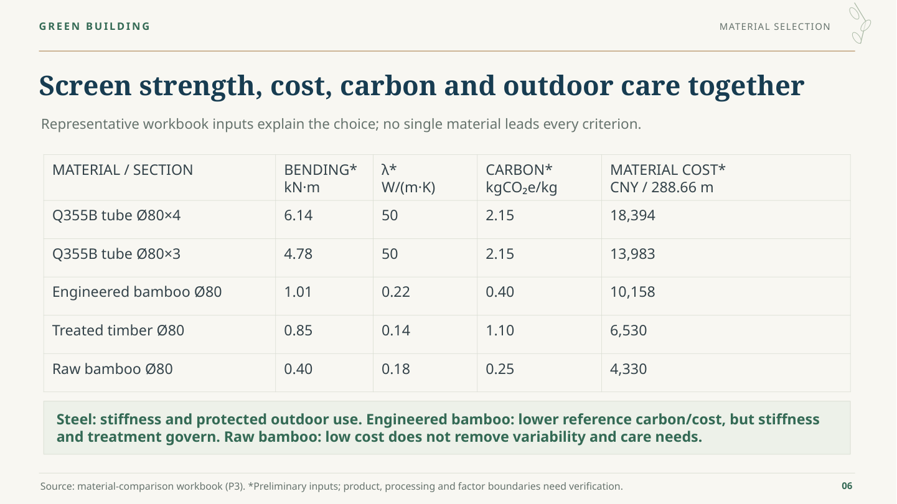

## Slide 07 — The crown is stiffness-sensitive: joints matter

## Slide 08 — The unit budget includes fabrication, installation and care

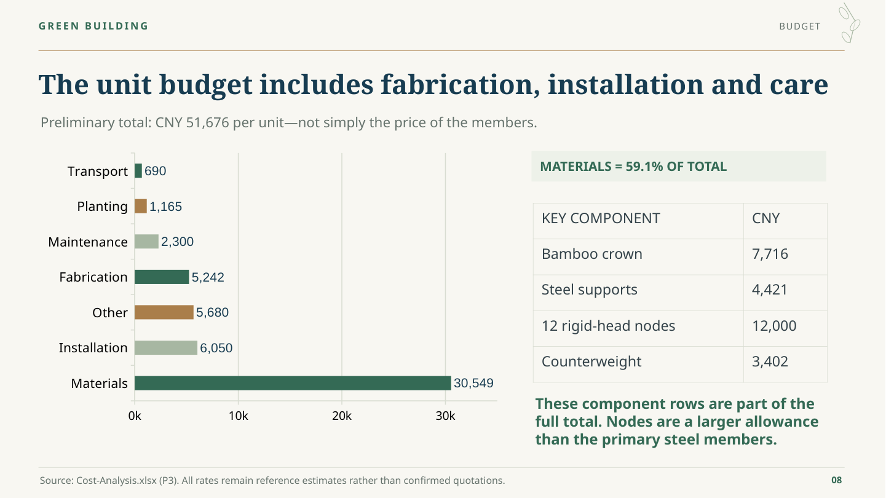

## Slide 09 — Account for the members, base and maintenance needs

## Slide 10 — Select climbers for support, season and maintenance

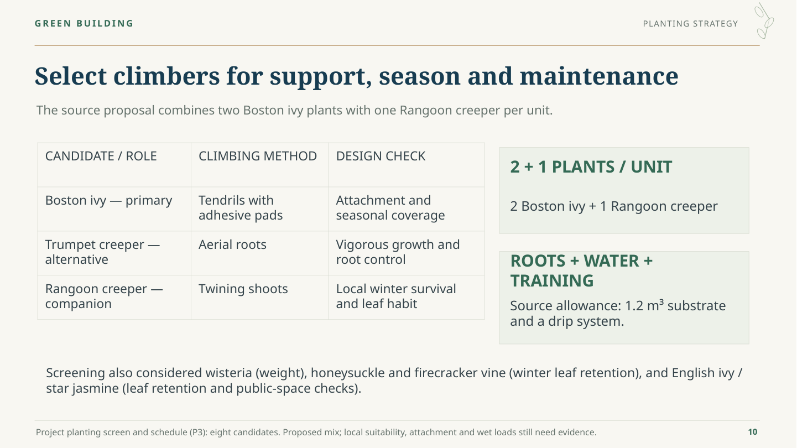

## Slide 11 — Opening the structure is not the same as a mature canopy

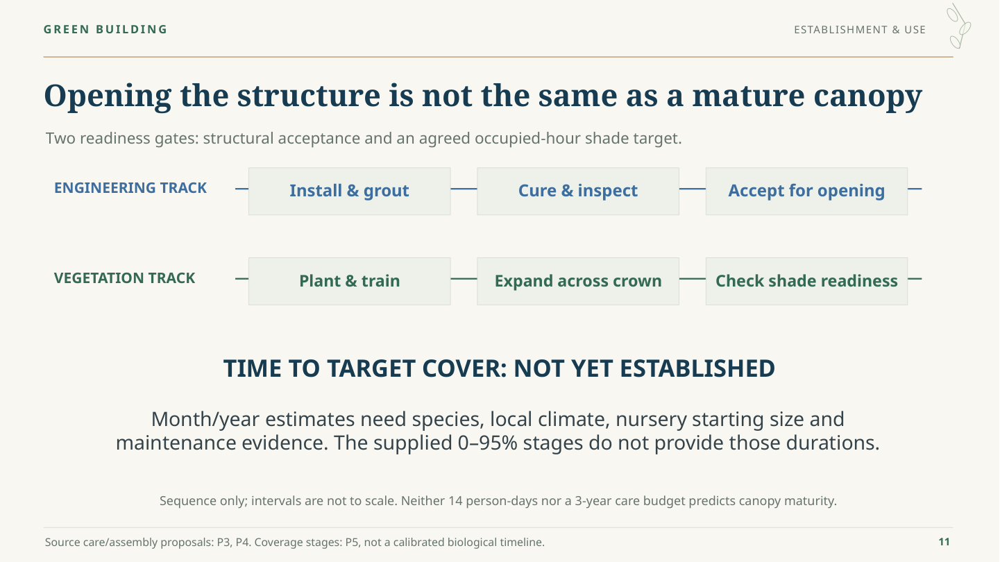

## Slide 12 — Different mechanisms need different evidence

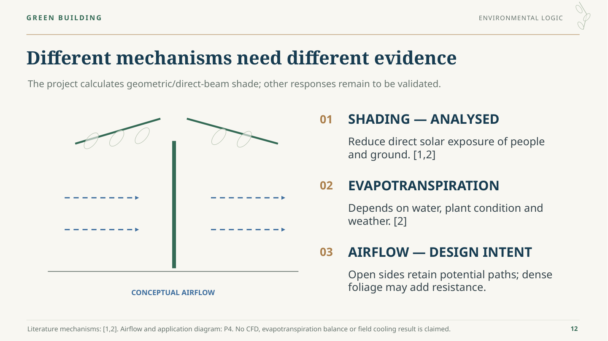

## Slide 13 — Project shade onto one fixed reference zone

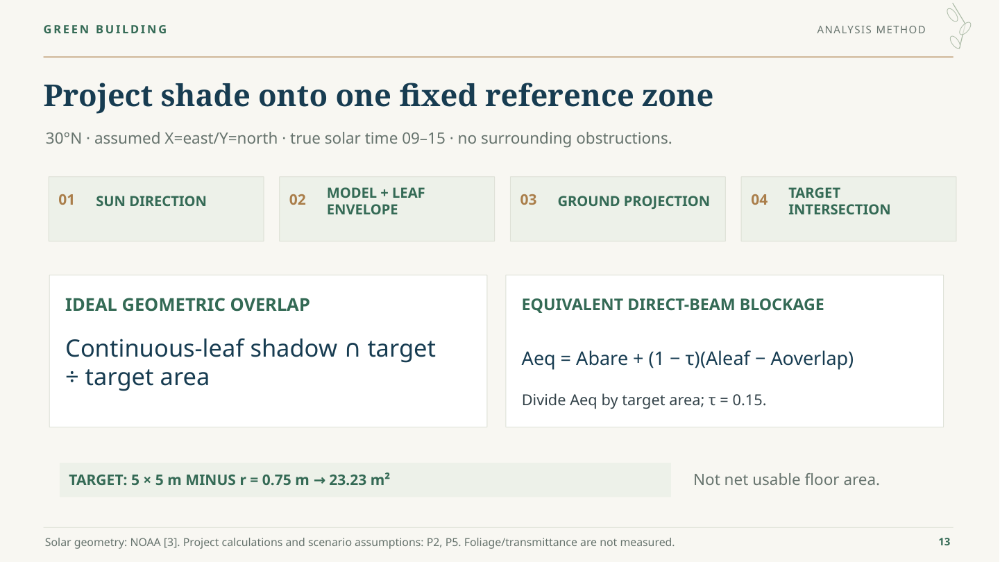

## Slide 14 — The shadow position and solar season both matter

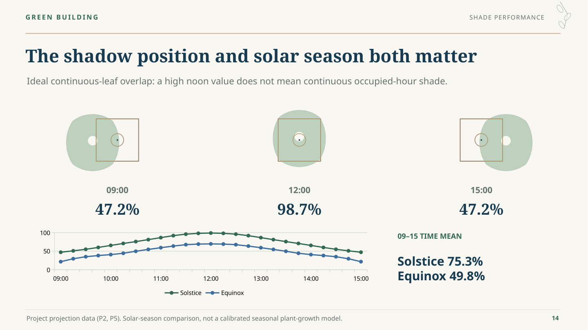

## Slide 15 — Seven models test three geometry controls

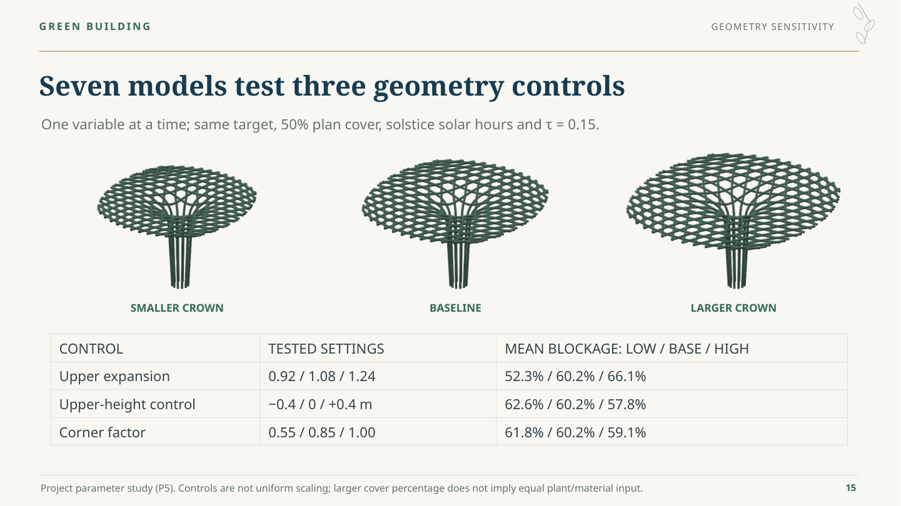

## Slide 16 — Coverage amount alone does not determine useful shade

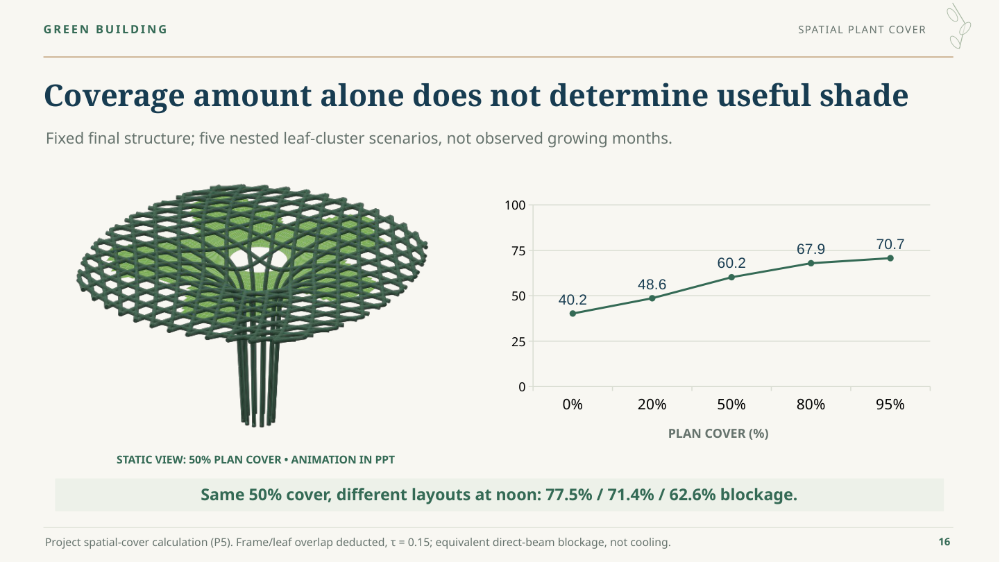

## Slide 17 — Put occupied-hour shade into the layout decision

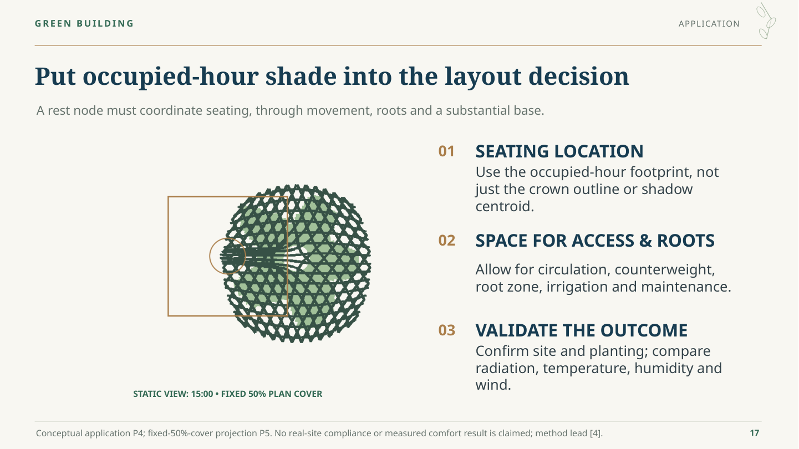

## Slide 18 — Coordinate prefabricated modules and site interfaces

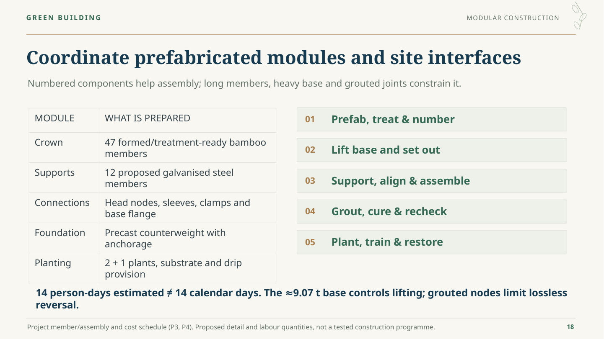

## Slide 19 — Connect geometry, construction and useful shade

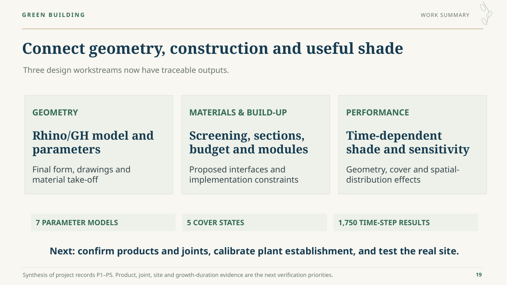

## Slide 20 — References and project evidence

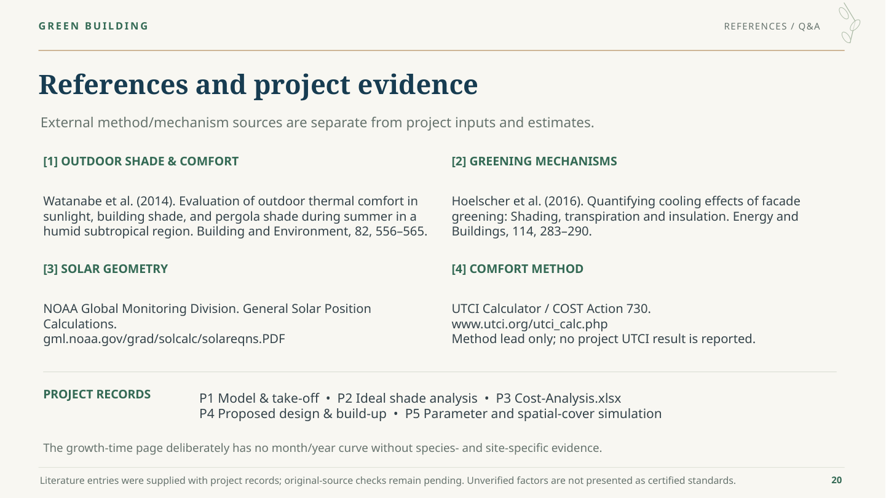
