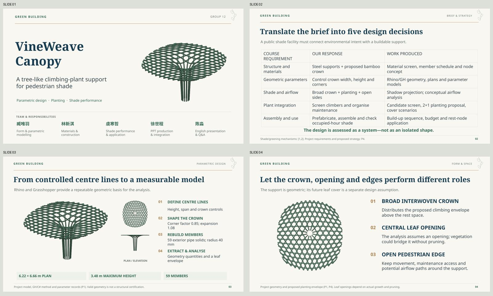

# VineWeave Canopy — Expanded Editable Draft V2

**green building · Group 12 · 20 slides including the reference/Q&A page.**

- **[View all slides](Preview.md)**
- **[Editable PowerPoint](VineWeave-Canopy-v2.pptx)**
- **[Static PDF](VineWeave-Canopy-v2.pdf)**
- **[Presenter guide: English script + Chinese cues + Q&A](Presenter-Guide-v2.md)**
- [Presenter guide in Word](Presenter-Guide-v2.docx)
- [Changes and material coverage](Changes-and-Coverage.md)

## Changes responding to feedback

The cover is title-led, with a model and small five-member responsibility band. Technical pages now include the method, selection rationale and interpretation that the first draft omitted. Added/recovered content includes the modelling workflow, member sections and quantities, five representative material inputs, load/boundary/deflection logic, node concept, cost drivers, planting screen and 2+1 mix, readiness timeline, all three parameter-study families, all five cover results, spatial distribution and implementation modules.

## Plant selection and the time diagram

Slide 10 presents the source proposal of **two Boston ivy plants and one Rangoon creeper**, with trumpet creeper as an alternative; climate/attachment suitability is not certified.

Slide 11 distinguishes engineering acceptance from vegetation shade readiness. **It does not assign months or years.** No reliable cover-versus-time data were supplied, so the diagram is explicitly a sequence with uncalibrated intervals, not a fabricated growth curve. The source’s training note, labour days and care-budget years are not treated as maturity predictions.

## Editability and animation

Visible titles, descriptions, tables, analytical charts and diagram shapes are native PowerPoint objects. There are **nine editable tables and five native charts**, each chart with an embedded workbook. The source-model renderings and GIFs remain images. No AI redraw is used for evidence geometry.

Slides 16–17 embed text-free cover/daytime-shadow animations. All 5/25 frames are preserved; actual GIF playback and fonts still need checking in the presentation software. Browser images and PDF use representative 50%-cover and 15:00 static views.

## Presenter support and timing

Working draft: 1129 spoken English words including transitions on slides 1–19. Continuous speech is approximately 8.4–9.4 minutes at 120–135 words/minute, before figure pauses and slide changes. Rehearse toward about 9 minutes and reserve question time. Timing has not been validated by rehearsal.

Each slide has embedded notes with a takeaway, spoken script, transition and Q&A. The separate guide adds Chinese cues. Material completeness was increased on screen without adding unverified experiments or filling the slides with full reports.

## Validation and limits

See [Validation.md](Validation.md). All 20 pages were rendered and reviewed; long headings, a numbered-label collision and dense time labels were corrected. Native chart caches were compared with the chosen project inputs. Model-comparison views retain common scale and camera.

Geometry and optical scenarios do not certify structural safety, real wind/thermal response, plant duration, product factors or quotations. Literature entries are source leads supplied with project materials; original-source verification remains pending.

Source generator: [build_deck.cjs](source/build_deck.cjs). Figures are reused from the first-draft native-data rendering pipeline; original private attachments are not duplicated here. PPT/PDF files are self-contained. LibreOffice static rendering may differ from Microsoft PowerPoint.
