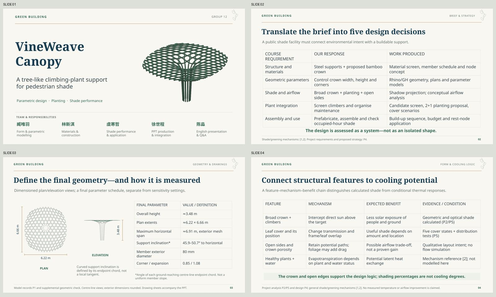

# VineWeave Canopy — V3

English green building group presentation. **19 slides including references**, satisfying the course’s strict “Less than 20 pages” requirement.

- [Preview every slide](Preview.md)
- [Editable PowerPoint](VineWeave-Canopy-v3.pptx) · [Static PDF](VineWeave-Canopy-v3.pdf)
- [Download review/submission bundle](Course-Submission-v3.zip)
- [Presenter guide](Presenter-Guide-v3.md) · [Word](Presenter-Guide-v3.docx)
- [Course requirement coverage](Requirement-Matrix.md) · [Validation](Validation.md)

## Changes from V2

Merged canopy-layout and environmental-mechanism material into a feature → mechanism → expected benefit → evidence table. Added dimensioned plan/elevation views, a final parameter schedule with defined maximum span and support inclination, and explicit durability/environmental-adaptability reasoning. The title-led cover and all five core roles remain on page 1. Plant selection, readiness stages, geometry sensitivity, coverage scenarios and modular construction remain in the deck.

## Companion deliverables

- [Two-sheet technical drawings, A3 PDF](submission/Technical-Drawings.pdf): general arrangement with plan, elevation and inclination definition; member schedule and conceptual interfaces. These are schematic design drawings, not fabrication or certified engineering documents.
- [One-page integrated English design brief, PDF](submission/One-Page-Design-Brief.pdf) · [Editable Word](submission/One-Page-Design-Brief.docx).
- [Editable material, final-parameter, cost and cooling-logic schedules](submission/Material-Parameter-and-Cost-Schedules.xlsx).

The bundle contains these deliverables and the presentation, plus a presenter guide. Original private source attachments are not republished.

## Editability and presenter support

Text, dimension labels, tables, analytical charts and diagram shapes are native PowerPoint objects; model views and two GIFs remain images. Five native charts each retain an embedded workbook. Animation pages 15–16 retain 5/25 frames; actual PowerPoint playback needs checking in the presentation software. PDF and gallery show static keyframes.

1100 spoken English words including transitions on slides 1–18. At 120–135 words/minute, continuous speech is about 8.1–9.2 minutes before figure pauses and slide changes. Rehearse toward 9 minutes, leaving question time within the 10–12 minute total. Timing is not yet validated by rehearsal.

## Evidence limits

The plant-selection page retains the source 2 Boston ivy + 1 Rangoon creeper proposal, subject to local suitability checks. The readiness page is a stage sequence, not a month/year growth prediction. Shade percentages are optical model outputs, not measured temperature changes. Airflow is discussed qualitatively. Product parameters, joint/global behaviour, actual site, prices and literature originals remain verification priorities. No street-rendering or sensor extension was added.

No date or school logo is placed on the slides. No course email was sent. Source: [deck generator](source/build_deck.cjs), [submission generator](source/prepare_submission.py).
