# VineWeave Canopy — V5 Preview

**18 slides including references.** [Editable PowerPoint](VineWeave-Canopy-v5.pptx) · [Static PDF](VineWeave-Canopy-v5.pdf) · [Presenter guide](Presenter-Guide-v5.md)

Plant-establishment timing and the four-stage growth-concept page have been removed. Spatial coverage comparisons and the illustrated cooling mechanisms remain.

## 01 — VineWeave Canopy

## 02 — Translate the brief into five design decisions

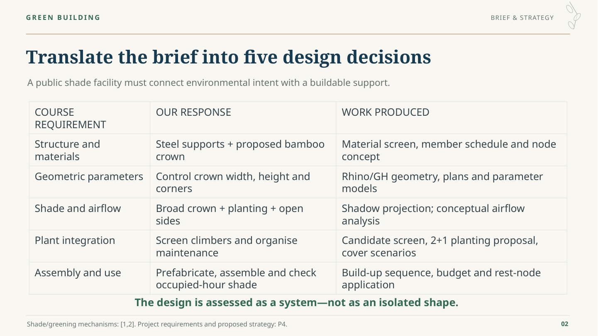

## 03 — Define the final geometry—and how it is measured

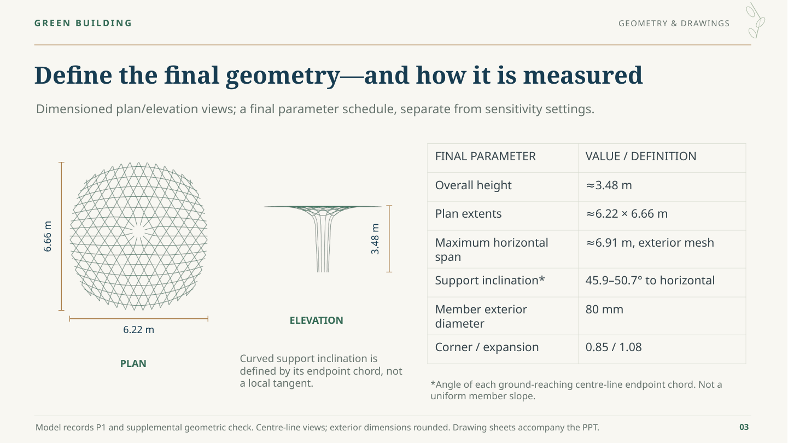

## 04 — How the canopy can improve pedestrian comfort

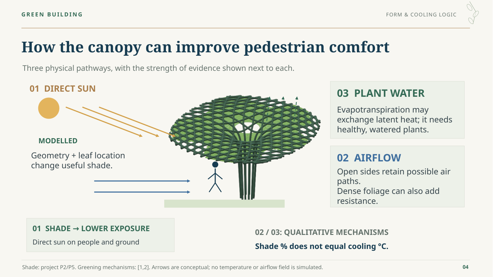

## 05 — Separate the support role from the crown role

## 06 — Five criteria guide the material selection

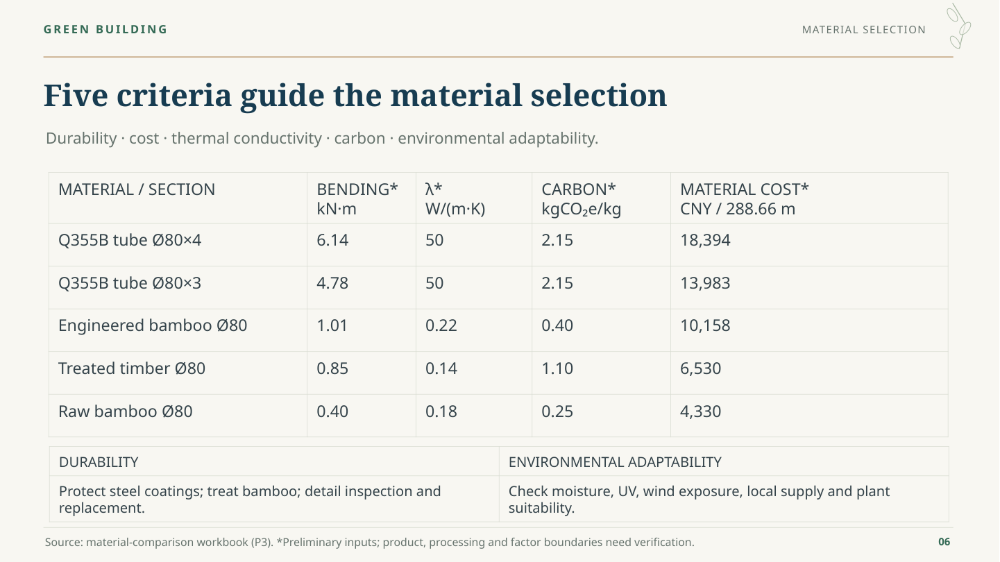

## 07 — The crown is stiffness-sensitive: joints matter

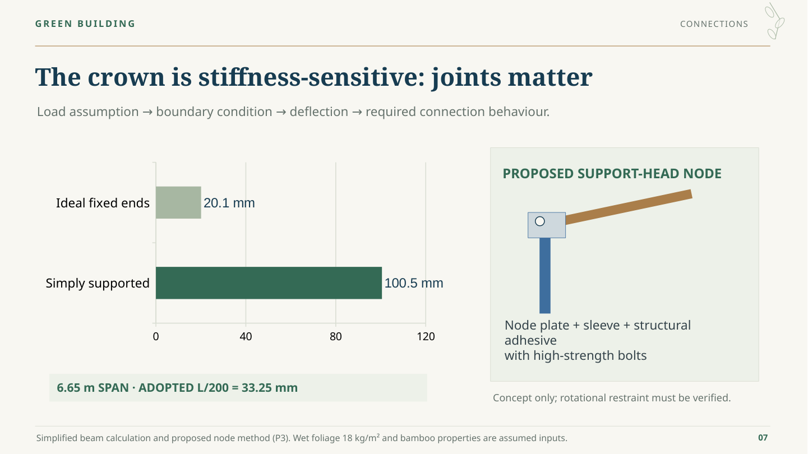

## 08 — The unit budget includes fabrication, installation and care

## 09 — Account for the members, base and maintenance needs

## 10 — Keep the planting mix conditional on the site

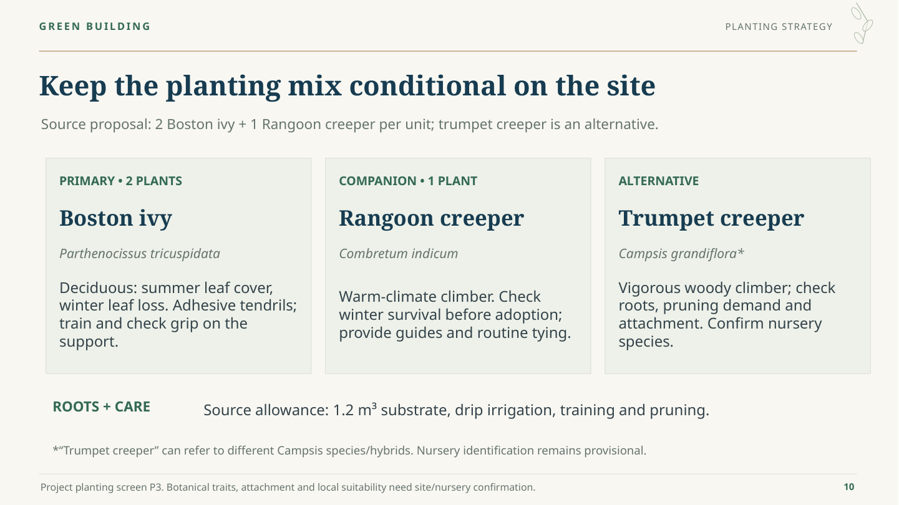

## 11 — Project shade onto one fixed reference zone

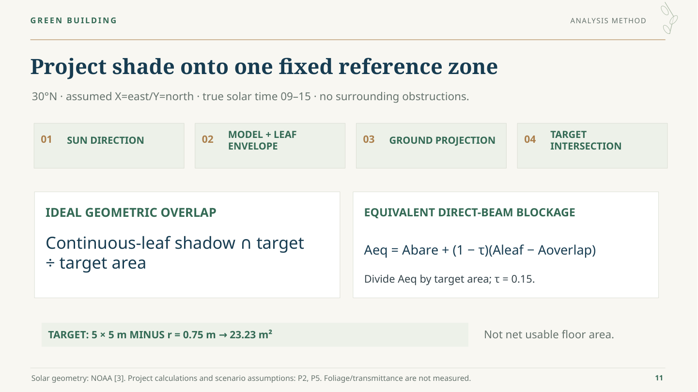

## 12 — The shadow position and solar season both matter

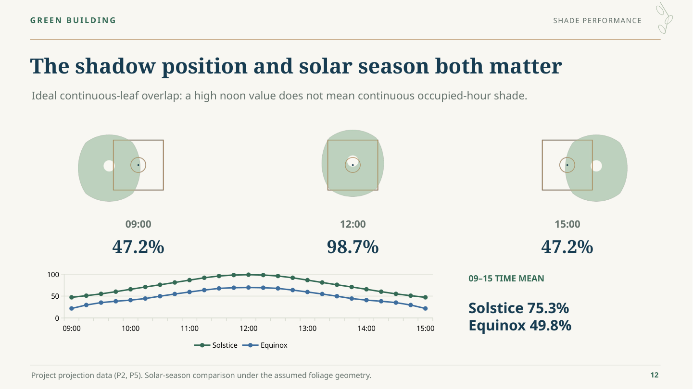

## 13 — Seven models test three geometry controls

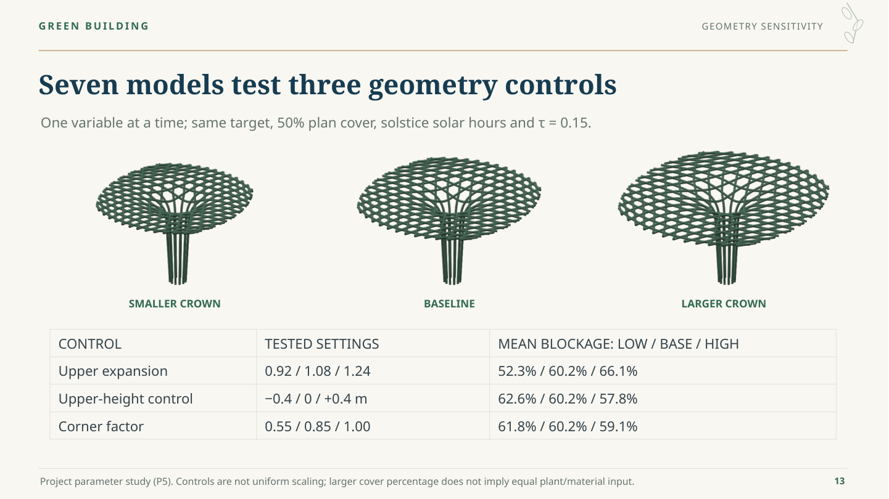

## 14 — Coverage amount alone does not determine useful shade

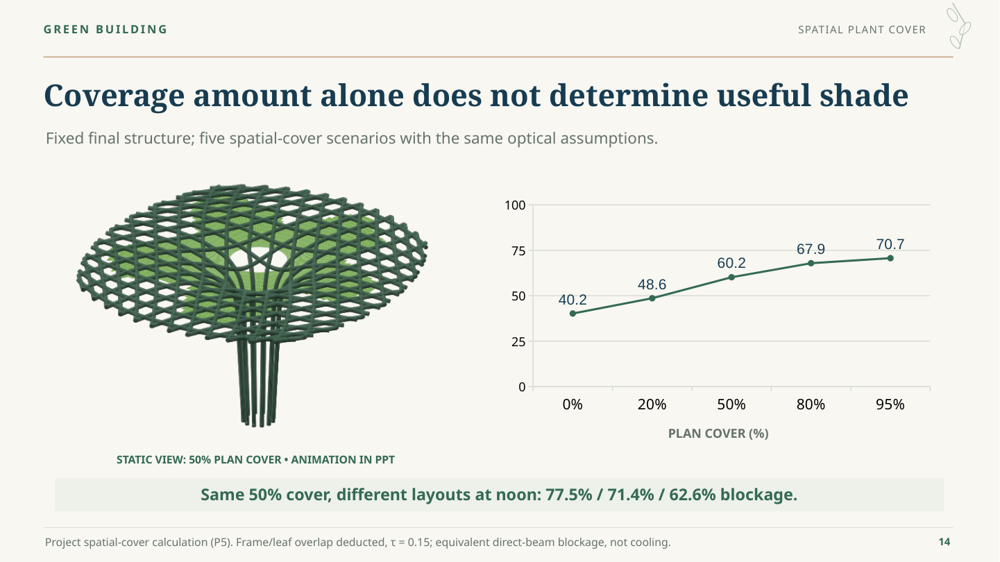

## 15 — Put occupied-hour shade into the layout decision

## 16 — Coordinate prefabricated modules and site interfaces

## 17 — Connect geometry, construction and useful shade

## 18 — References and project evidence

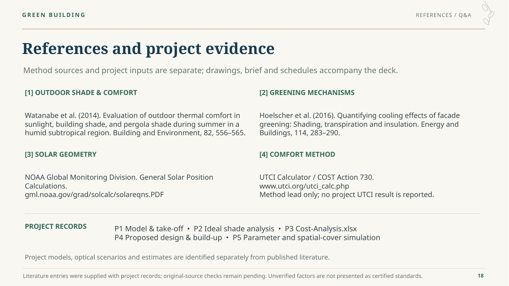
