# VineWeave Canopy — V6 Preview

**17 slides including references.** [Editable PowerPoint](VineWeave-Canopy-v6.pptx) · [Static PDF](VineWeave-Canopy-v6.pdf) · [Presenter guide](Presenter-Guide-v6.md)

Course-requirement mapping page removed; plant-growth timing remains removed. Spatial coverage comparisons and illustrated cooling mechanisms retained.

## 01 — VineWeave Canopy

## 02 — Define the final geometry—and how it is measured

## 03 — How the canopy can improve pedestrian comfort

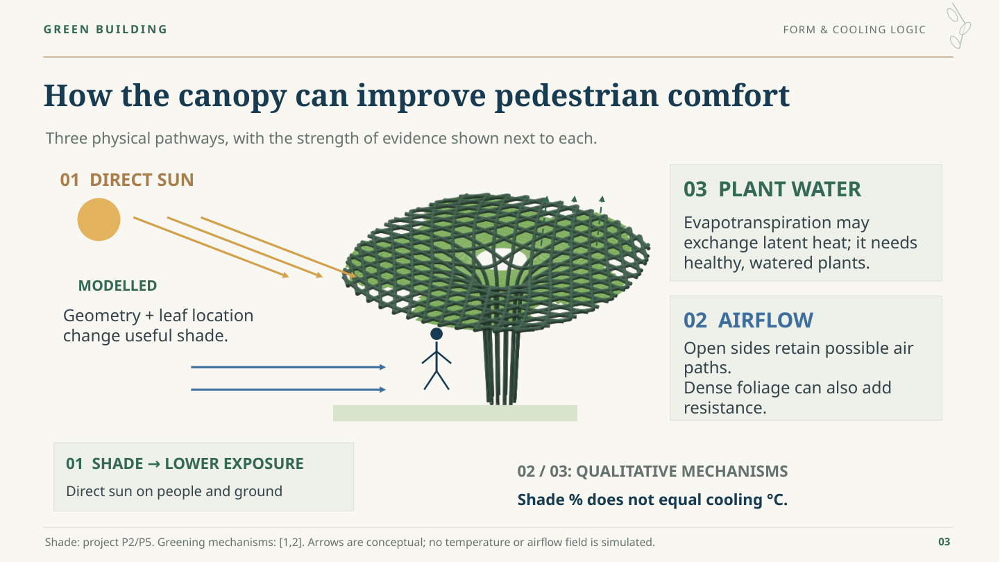

## 04 — Separate the support role from the crown role

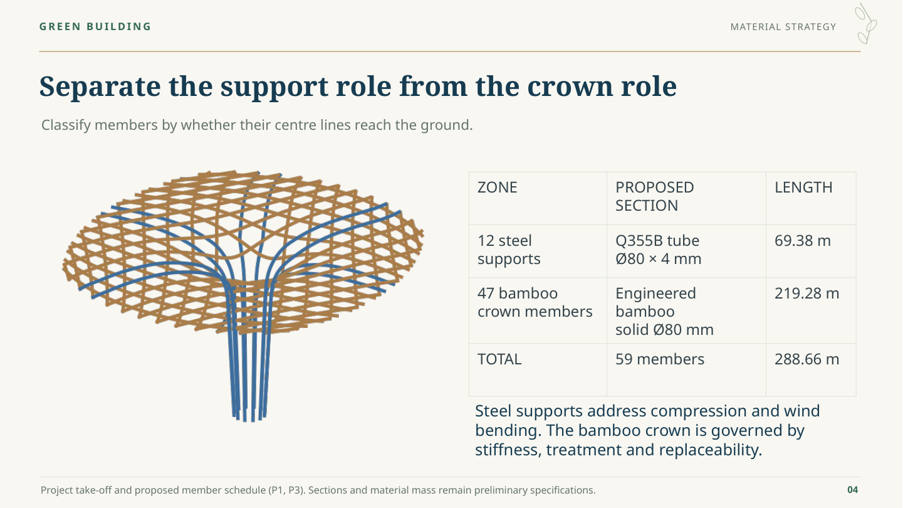

## 05 — Five criteria guide the material selection

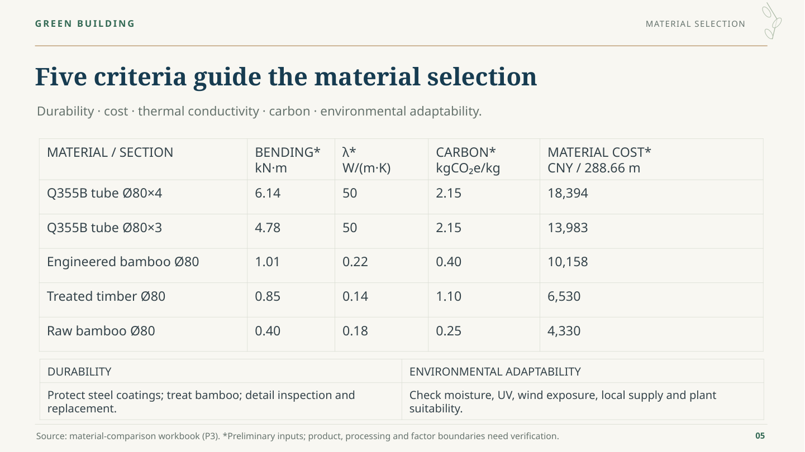

## 06 — The crown is stiffness-sensitive: joints matter

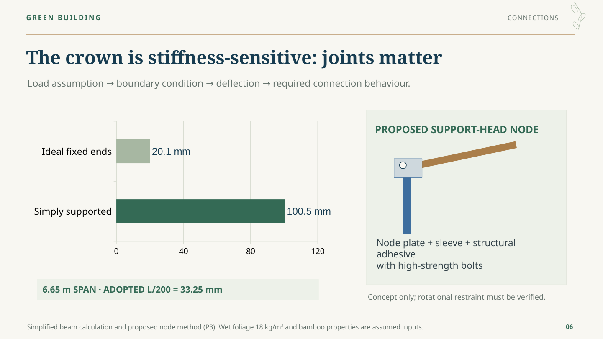

## 07 — The unit budget includes fabrication, installation and care

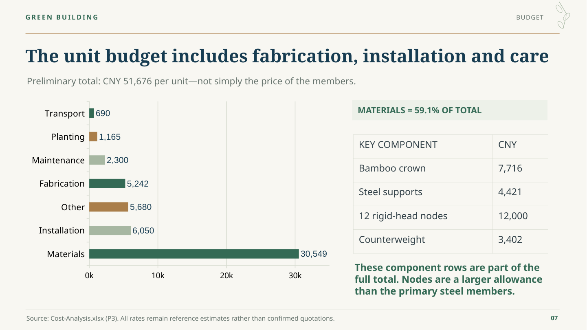

## 08 — Account for the members, base and maintenance needs

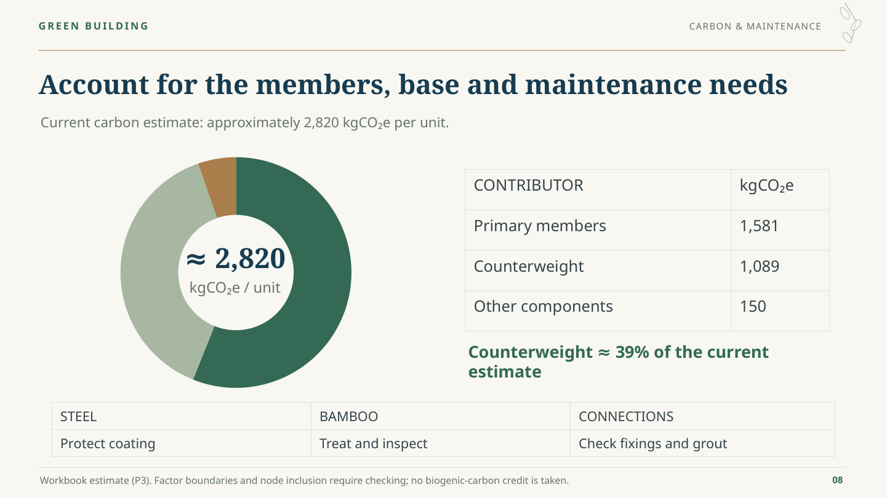

## 09 — Keep the planting mix conditional on the site

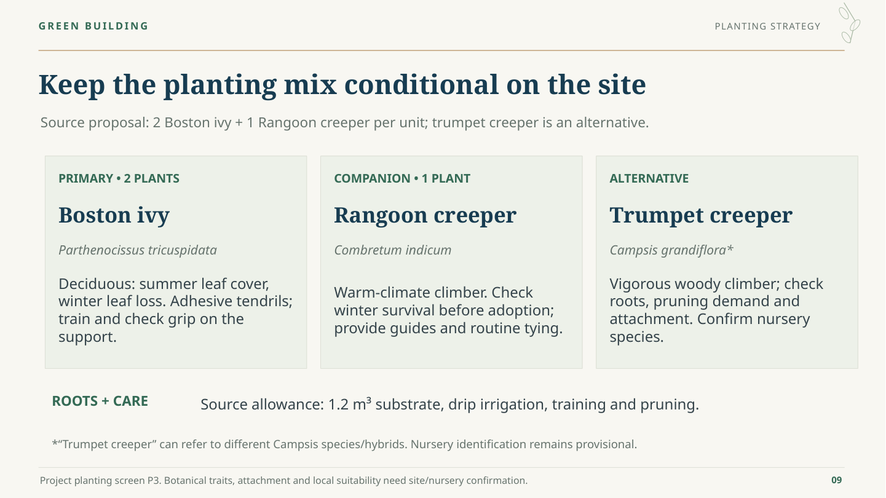

## 10 — Project shade onto one fixed reference zone

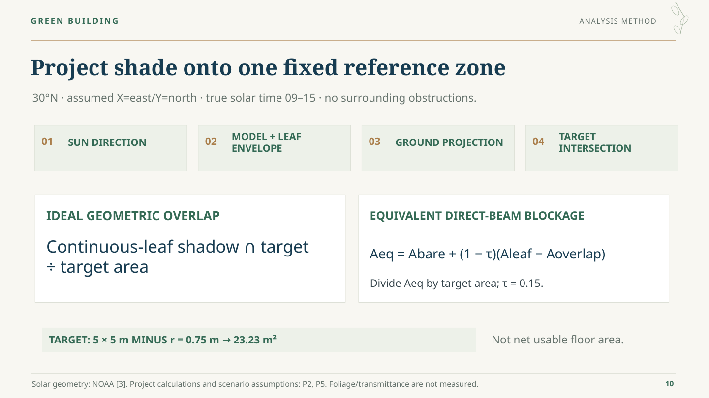

## 11 — The shadow position and solar season both matter

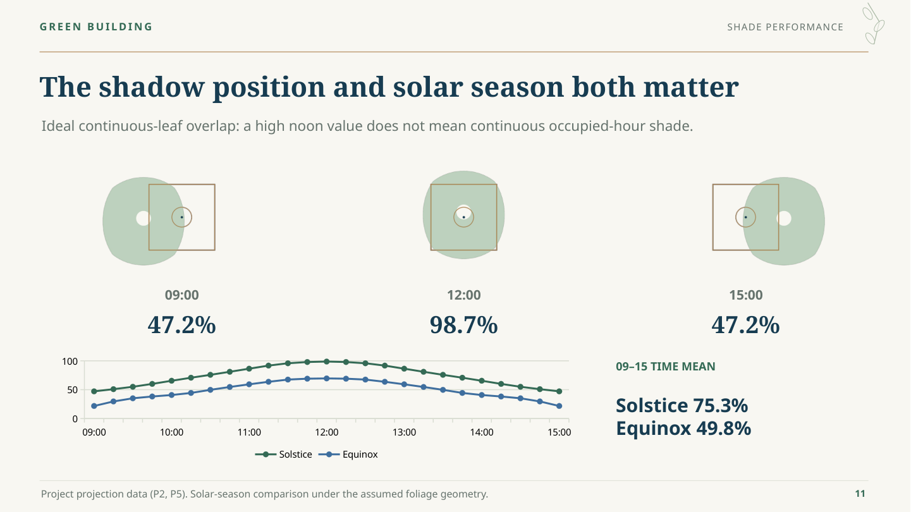

## 12 — Seven models test three geometry controls

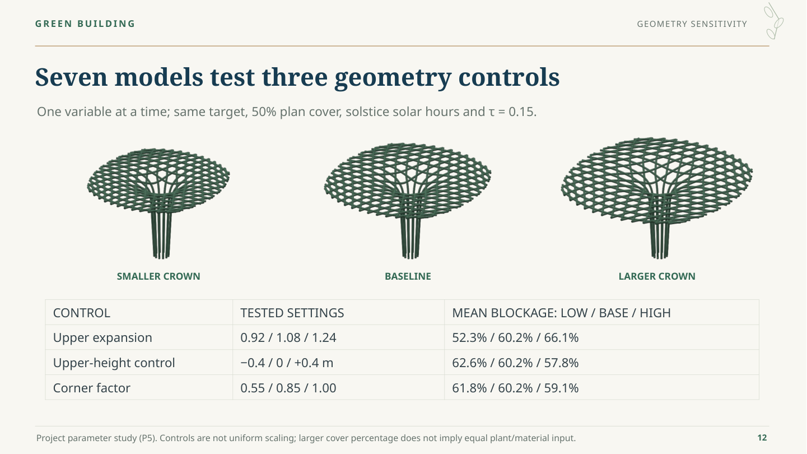

## 13 — Coverage amount alone does not determine useful shade

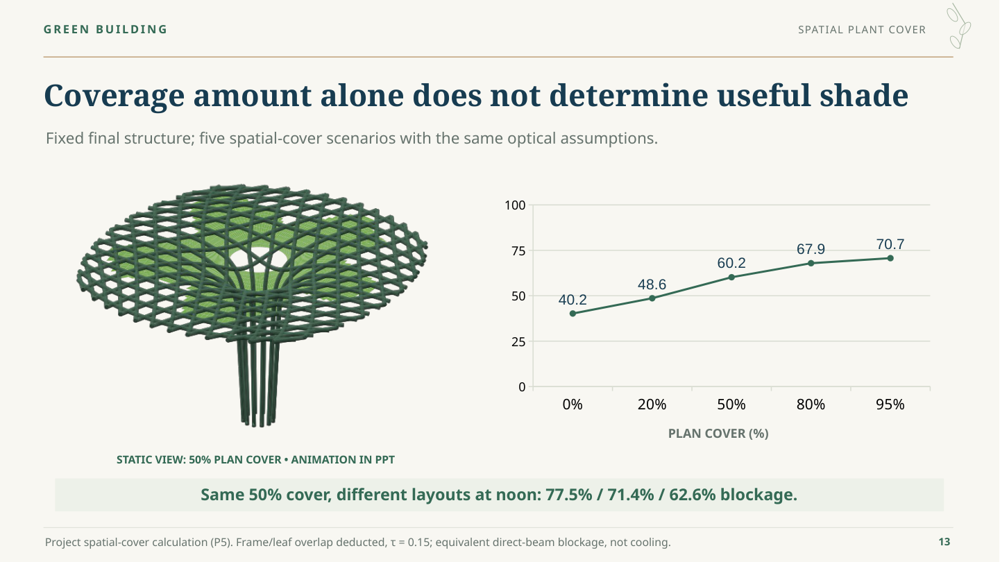

## 14 — Put occupied-hour shade into the layout decision

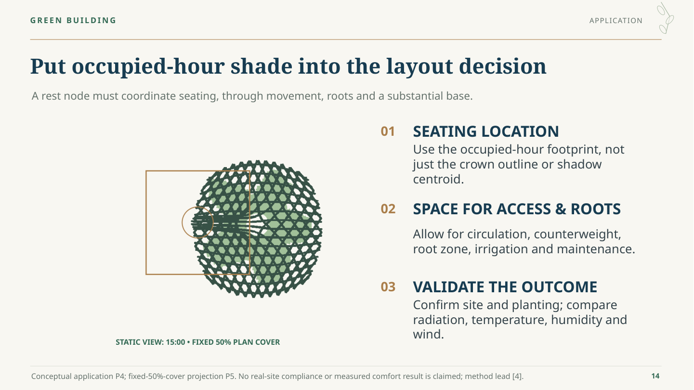

## 15 — Coordinate prefabricated modules and site interfaces

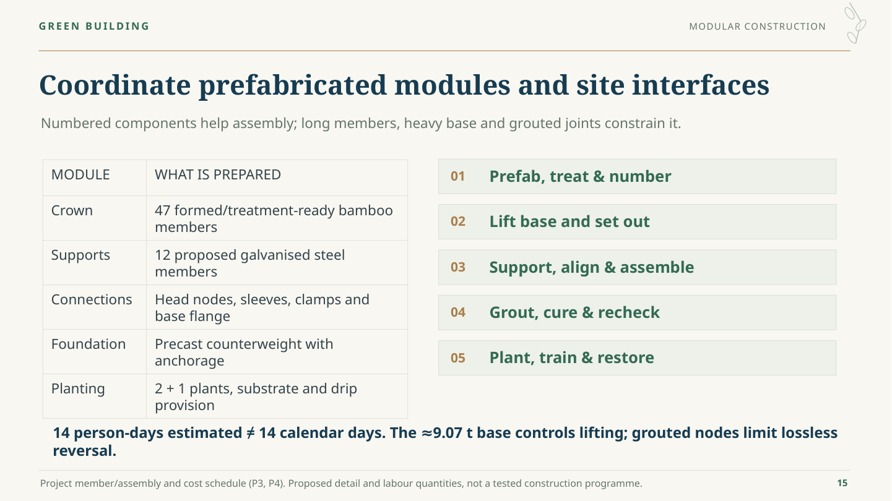

## 16 — Connect geometry, construction and useful shade

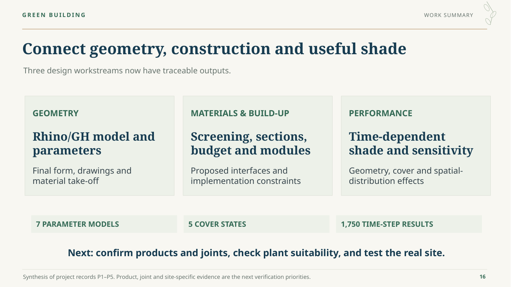

## 17 — References and project evidence

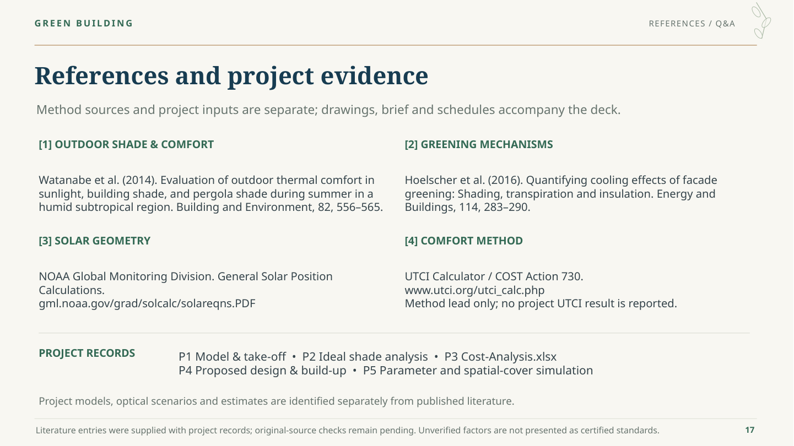
