# VineWeave Canopy — V7

**18 slides including references.** [Editable PowerPoint](VineWeave-Canopy-v7.pptx) · [PDF](VineWeave-Canopy-v7.pdf) · [Presenter guide](Presenter-Guide-v7.md) · [Statement/source audit](Statement-Evidence.md)

Material reasoning: pages 4–6. Node/deflection: page 7. Shade methods/results: pages 11–14. No plant-growth timing or course-mapping page.

## 01 — VineWeave Canopy

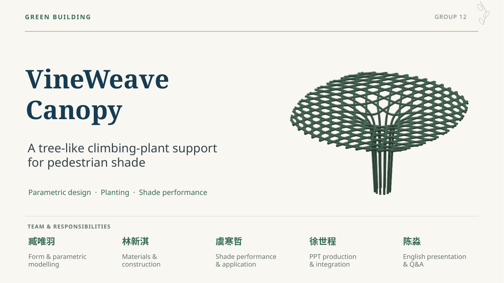

## 02 — Define the final geometry—and how it is measured

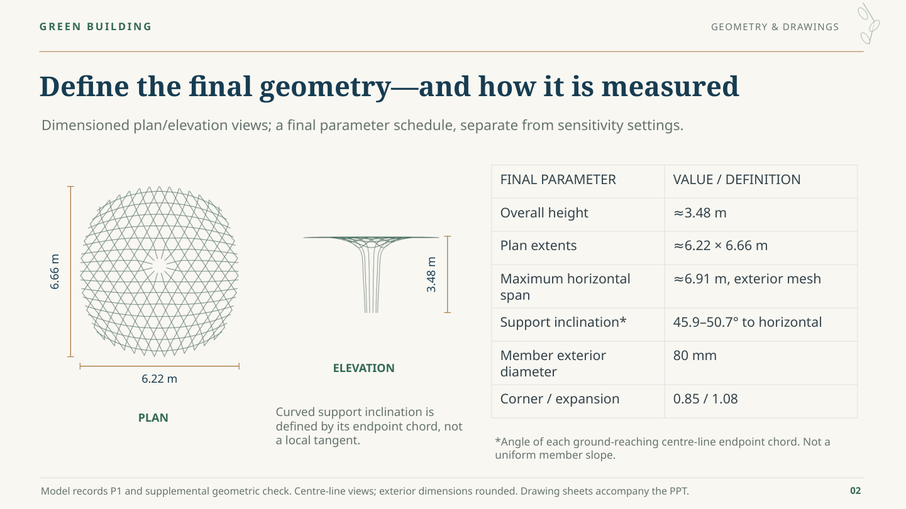

## 03 — How the canopy can improve pedestrian comfort

## 04 — Assign materials to the roles they must perform

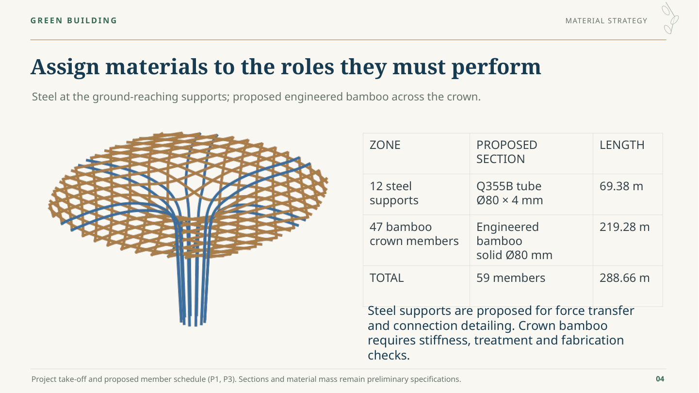

## 05 — Read the material inputs before making the choice

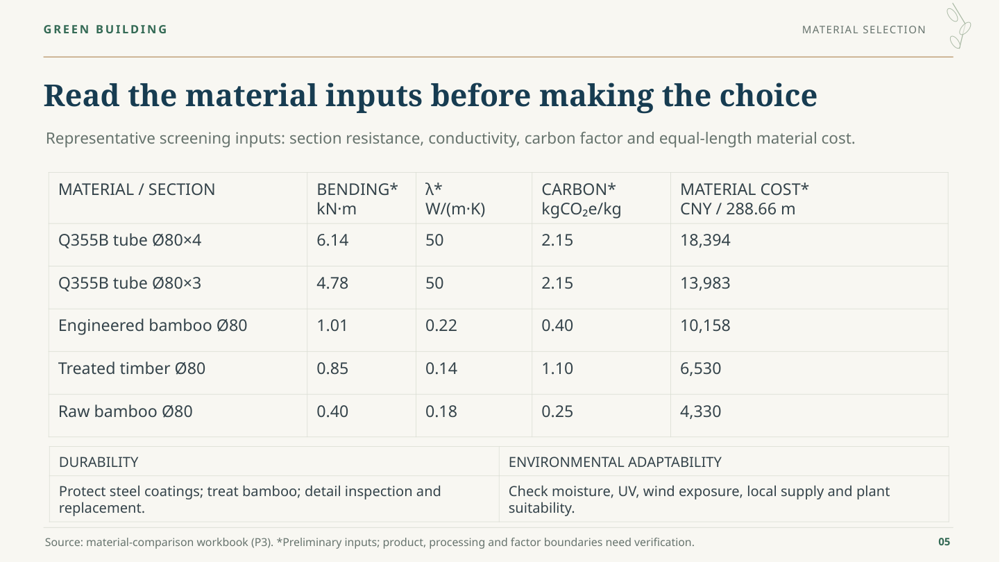

## 06 — Why steel supports and an engineered-bamboo crown?

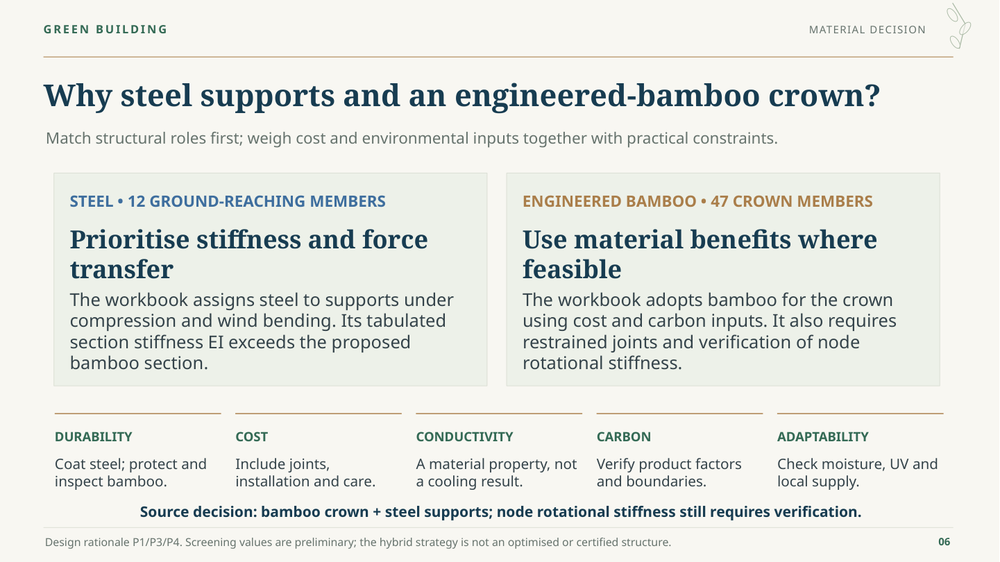

## 07 — The beam check sets a requirement for the joint

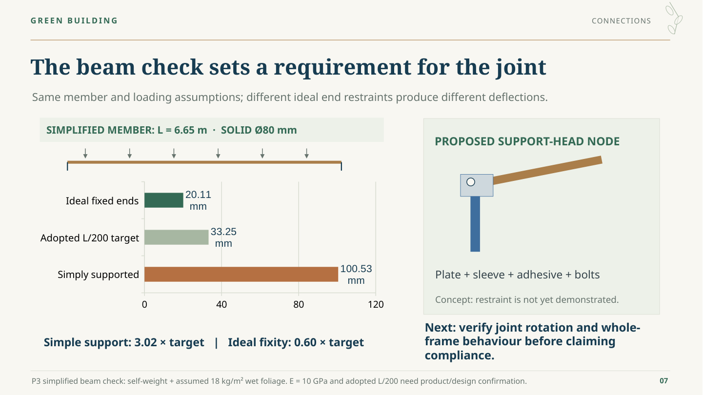

## 08 — The unit budget includes fabrication, installation and care

## 09 — Account for the members, base and maintenance needs

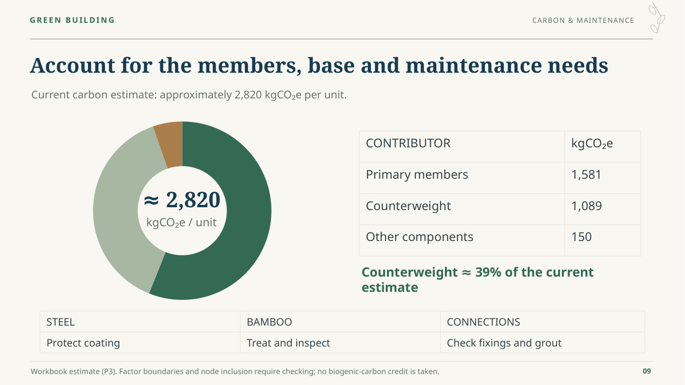

## 10 — Keep the planting mix conditional on the site

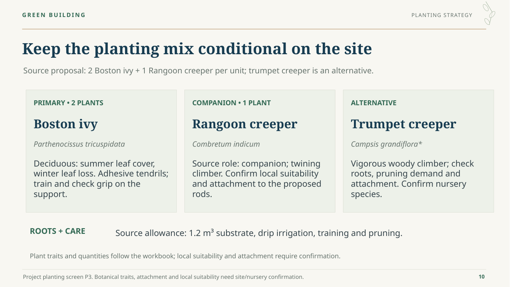

## 11 — Two shade metrics answer different questions

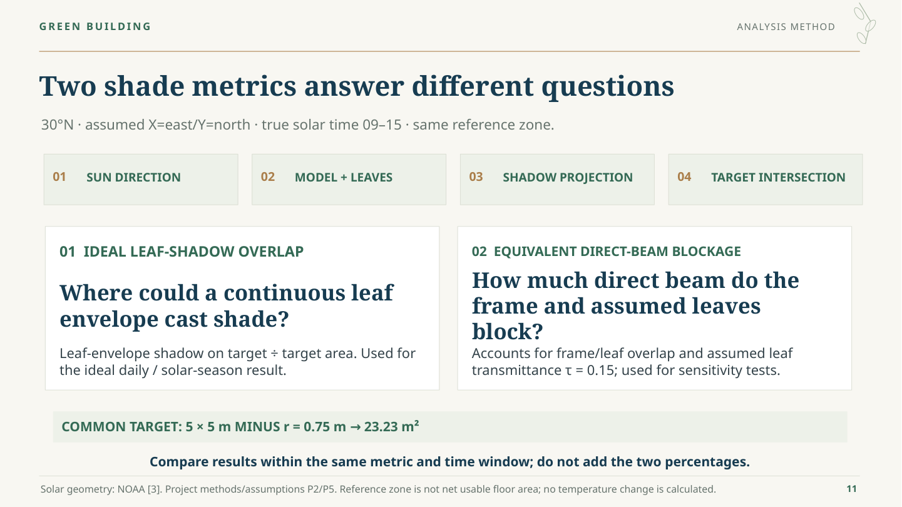

## 12 — A noon peak does not ensure all-day shade

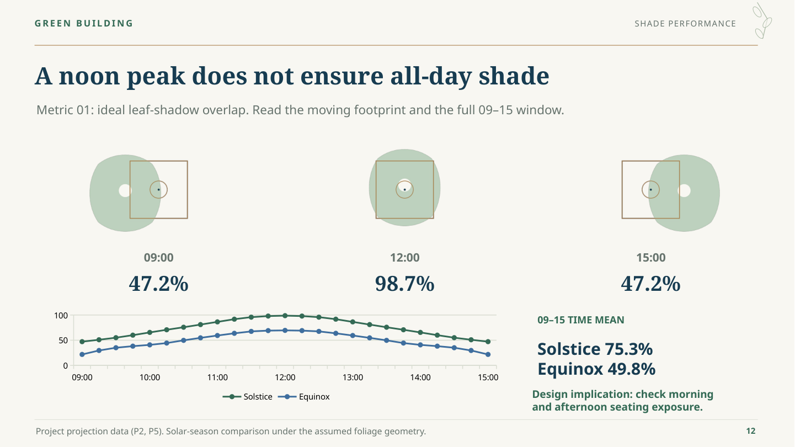

## 13 — Expanding the crown raises mean blockage: 52.3% → 66.1%

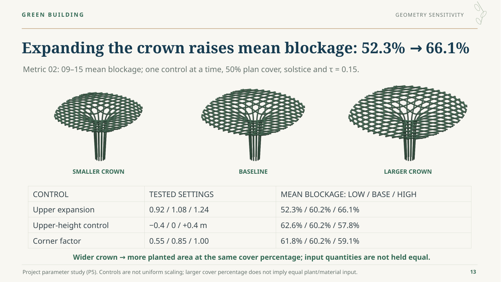

## 14 — Coverage amount alone does not determine useful shade

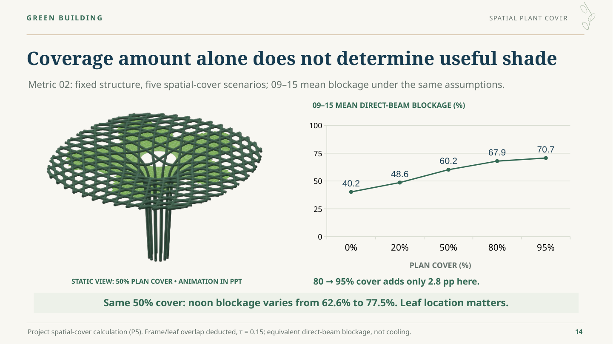

## 15 — Put occupied-hour shade into the layout decision

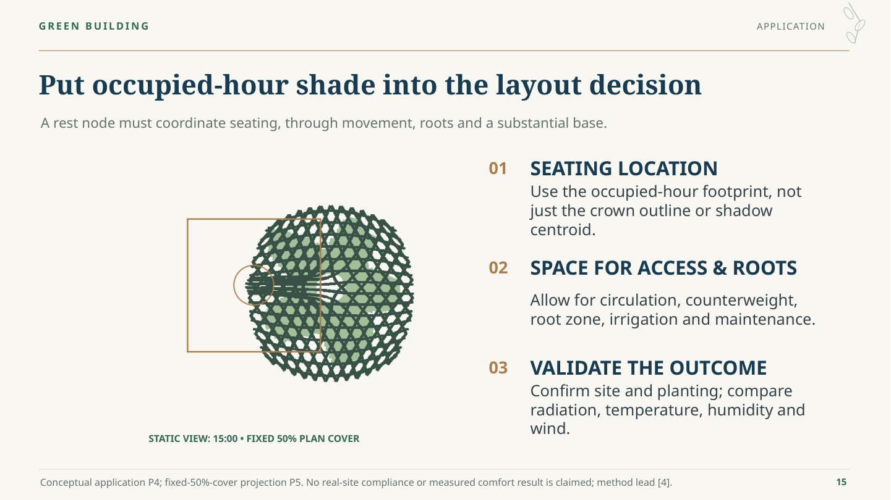

## 16 — Coordinate prefabricated modules and site interfaces

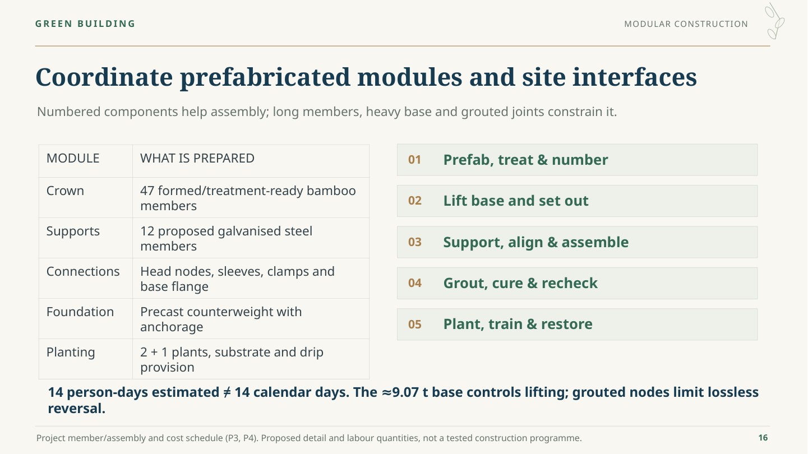

## 17 — Connect geometry, construction and useful shade

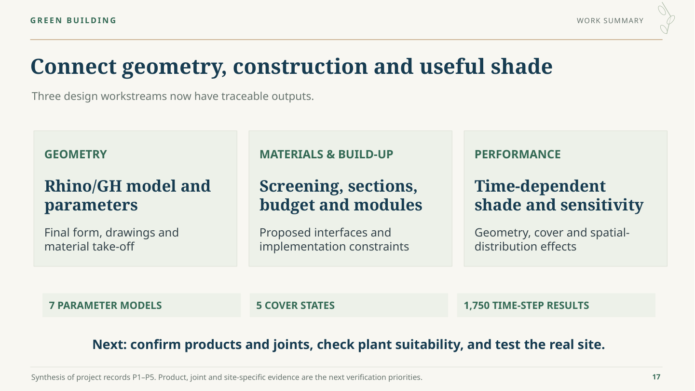

## 18 — References and project evidence

