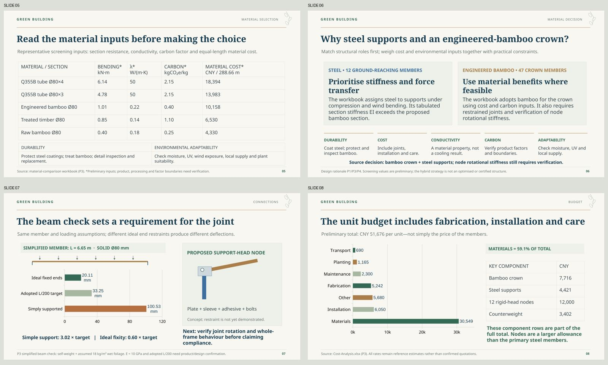

# VineWeave Canopy — V7

**18 English slides including references.** Material choice, node/deflection explanation and shade interpretation revised using the supplied project materials.

- **[View every slide](Preview.md)**
- [Editable PowerPoint](VineWeave-Canopy-v7.pptx) · [Static PDF](VineWeave-Canopy-v7.pdf)
- [Presenter guide with source basis](Presenter-Guide-v7.md) · [Word guide](Presenter-Guide-v7.docx)
- [Presentation bundle](Presentation-v7.zip)
- [Statement/source audit](Statement-Evidence.md) · [Numeric claim checks](Claim-Checks.json)
- [Changes and evidence status](Changes-and-Evidence.md) · [Validation](Validation.md)

One additional material-decision page separates the numeric screening table from the source’s hybrid-selection rationale. The node page now compares the two ideal beam cases with the adopted L/200 target. The shade-method page distinguishes continuous-envelope overlap from equivalent direct-beam blockage; results state their metric/time window and identify source-supported implications.

No new measurements, physical simulations, product evidence, plant-growth timing or engineering certification are claimed. The course-mapping page stays removed. Text, tables, analytical charts and mechanism shapes remain editable; model renders and GIFs remain images. Five charts retain embedded workbooks, and two GIFs remain on pages 14–15. Static gallery/PDF use keyframes.

Source references are embedded in all slide notes and repeated in the statement audit. Source assumptions are kept distinct from observations and arithmetic derived from the data. Original private attachments are not republished. Companion schematic drawings and schedules remain in [V3 deliverables](../v3/submission/).
