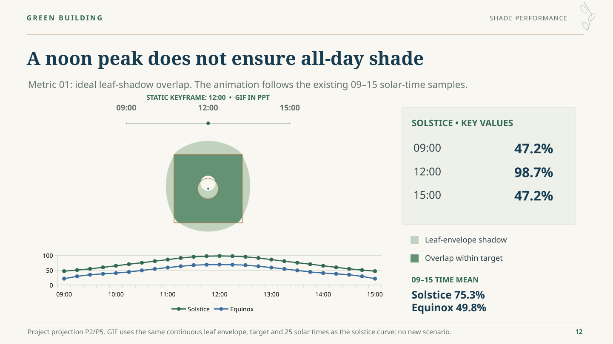

> Latest version: [V9 — plant wet-mass inputs and beam-load source linkage](../v9/README.md).

# VineWeave Canopy — V8

**18 slides including references. Page 12 now uses an animated ideal-shadow footprint.**

- **[Preview all slides and the new GIF](Preview.md)**
- [Editable PowerPoint](VineWeave-Canopy-v8.pptx) · [Static PDF](VineWeave-Canopy-v8.pdf)
- [New GIF](assets/ideal-shadow-sequence.gif)
- [Presenter guide](Presenter-Guide-v8.md) · [Word](Presenter-Guide-v8.docx)
- [Bilingual script](Bilingual-Script-v8.md) · [Bilingual Word](Bilingual-Script-v8.docx)
- [Presentation bundle](Presentation-v8.zip)
- [Statement/source audit](Statement-Evidence.md) · [Animation check](Ideal-Animation-Check.json)

## Animation and evidence

The former three still images on page 12 are replaced with a 25-frame GIF using the same baseline continuous-leaf envelope, target and 09:00–15:00 solstice solar times at 15-minute intervals. Each frame's ideal overlap was checked against the existing curve; maximum absolute difference is below 1e-8 percentage points. This is a different metric from the fixed-50%-cover frame/leaf animation on page 15.

Pale green is the leaf-envelope shadow; dark green is the portion within the reference target. A moving dot indicates solar time. All time labels, legend, key values and the analytical chart remain native editable objects. The GIF itself is an image. Playback loops in the GIF encoding; actual PowerPoint playback still needs checking in the presentation software.

The page retains 09/12/15 values 47.2/98.7/47.2%, the solstice/equinox curves and their time means. PDF/gallery show a static noon keyframe; the GIF is also embedded separately in the GitHub preview. No new geometry, foliage, weather, growth or thermal result was introduced. Other slides are unchanged from V7 apart from version metadata; page count remains 18.

Three GIFs retain 25/5/25 frames on pages 12/14/15. Five native charts retain workbooks. Source references remain in notes and the statement audit. See [validation](Validation.md).
