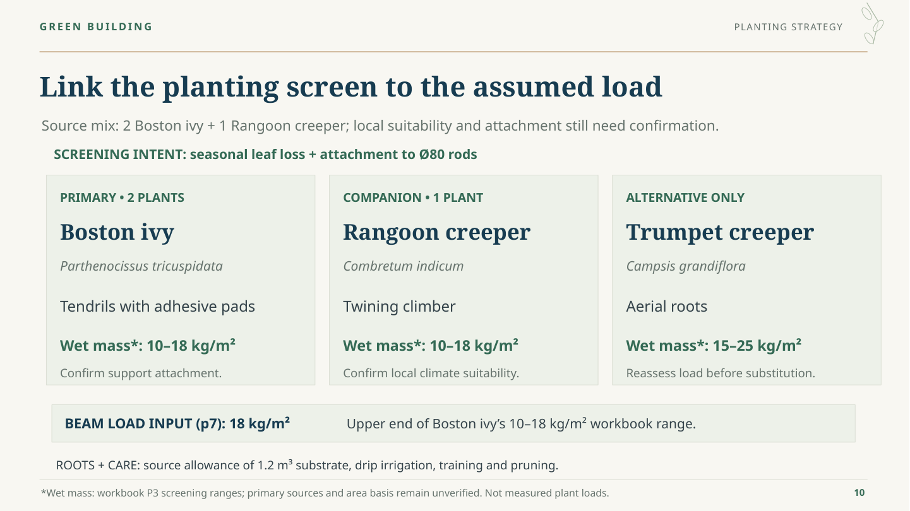

# VineWeave Canopy — V9

**18 slides including references. Plant page updated using the agreed minimal A revision.**

- **[Preview every slide](Preview.md)**
- [Editable PowerPoint](VineWeave-Canopy-v9.pptx) · [Static PDF](VineWeave-Canopy-v9.pdf)
- [Bilingual script](Bilingual-Script-v9.md) · [Bilingual Word](Bilingual-Script-v9.docx)
- [Presenter guide and sources](Presenter-Guide-v9.md) · [Word](Presenter-Guide-v9.docx)
- [Presentation bundle](Presentation-v9.zip)
- [Changes and evidence](Changes-and-Evidence.md) · [Statement audit](Statement-Evidence.md)

## Plant input linkage

The three-card layout remains. Cards now show adhesive tendrils / twining / aerial roots and the workbook wet-mass ranges 10–18 / 10–18 / 15–25 kg/m². The adopted 18 kg/m² beam input is explicitly linked to the upper end of the Boston ivy workbook range. Both the range and load remain assumptions: the original publication and area basis are unverified; no measured canopy load is claimed.

The alternative carries a load-review reminder. Seasonal leaf loss is presented as the workbook’s screening intent. Local climate and attachment remain checks. The unsupported star after the Latin name is removed, with a defined star now attached to the provisional wet-mass inputs. Roots/care quantities are retained.

No species was replaced. No growth-time estimate, LAI/leaf-thickness mass derivation, cold-tolerance threshold or Shanghai-specific winter-protection prescription was added. No original workbook was modified. Page 7 only gains a source cross-reference to page 10. Cost/carbon figures and design decisions are unchanged.

The three GIFs and five analytical charts are retained, including the page-12 ideal-shadow GIF. Text, plant ranges, footnotes and diagrams remain editable; rendered geometry/GIFs are images. Actual PowerPoint playback and timing still require rehearsal. [Validation](Validation.md).
