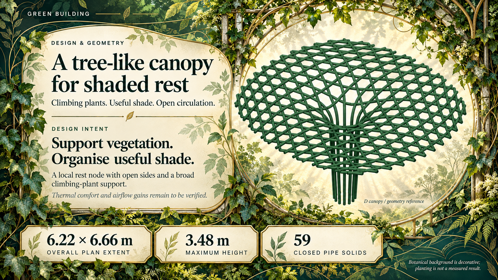

# Green Building — Botanical Style Demo

A one-slide style trial requested by the user: a more decorative background using climbing vines, ivy leaves, botanical linework, dappled light and an emerald/cream/gold palette.

Generated with the built-in image tool, following the image-based codex-ppt sample workflow. The previous codex-ppt sample was supplied as an image reference. All three geometry labels remain unchanged. The model was re-rendered by the image backend and is not a pixel-exact CAD evidence figure. Background vegetation is decorative, not measured planting or a confirmed site.

This is a sample for visual review, not the final first slide or the full deck. Text and shapes in this image are not individually editable. Awaiting user feedback before full production.

[Compare with the restrained sample](../codex-ppt-demo/README.md).
