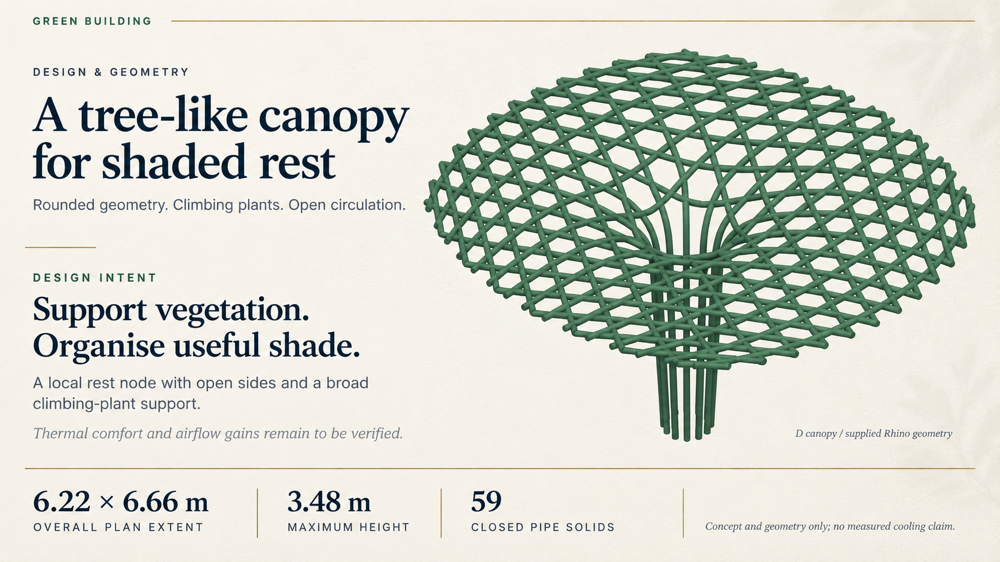

# codex-ppt — one-slide style trial

Generated with the [ningzimu/codex-ppt-skill](https://github.com/ningzimu/codex-ppt-skill) workflow using the built-in `image_gen.imagegen` backend. This is a sample awaiting visual approval, not the final group deck. No full-deck production or final PPT assembly has started.

- Content: the same D canopy concept and geometry metrics as the original demo.
- Style: warm ivory paper texture, navy serif headlines, forest green model and bamboo-gold rules.
- Source: the supplied D canopy model image was passed as a reference. The image backend has rendered the figure again, so this sample is a visual layout trial, not a pixel-exact CAD evidence reproduction.
- Image-based output: text and shapes are not individually editable. An editable conversion would be a separate step using the second skill and would require its own fidelity checks.
- The final first slide must show the five team members and responsibilities.
- No display date, school logo, field cooling claim or numerical airflow improvement is included.

## Status

One image generated and visually inspected for readable English, numerical labels, clipping and composition. Source-figure geometric identity is not independently certified. User approval is pending. PPT assembly is deferred until sample approval, following the skill's sample gate.

## Original demo

[Compare with the original editable demo](../README.md).
