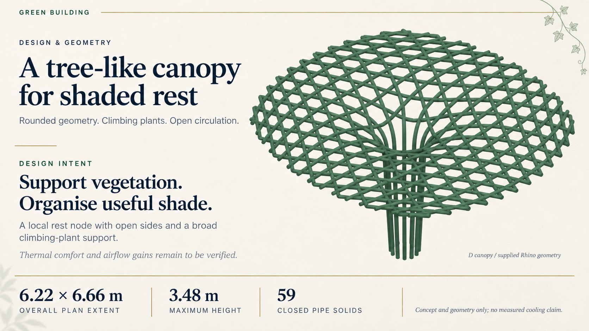

# Green Building — Subtle Botanical Demo

Revised following user feedback: retain the minimalist ivory layout, large model and clear typography; add only a small sage vine in the upper-right corner and a faint leaf shadow at the lower-left margin.

One image-based sample generated with the built-in image tool as an edit of the restrained codex-ppt sample. Text and numerical labels were visually checked. The model is an image-backend rendering, not a certified pixel-exact CAD figure. Decorative vines do not represent installed vegetation. Awaiting user review; the complete presentation has not been generated.
